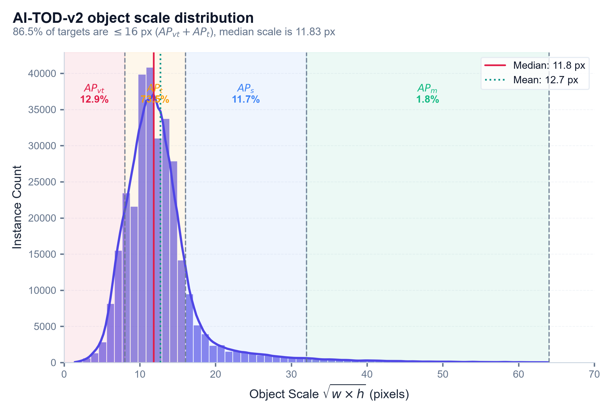
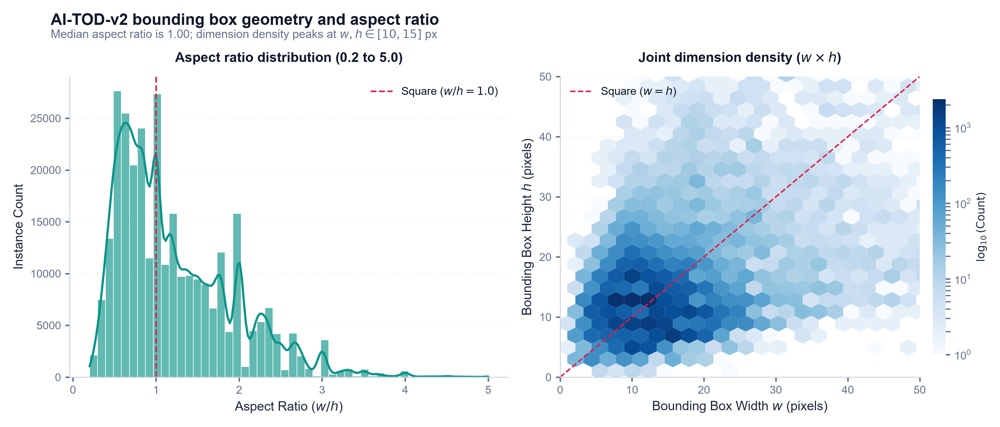
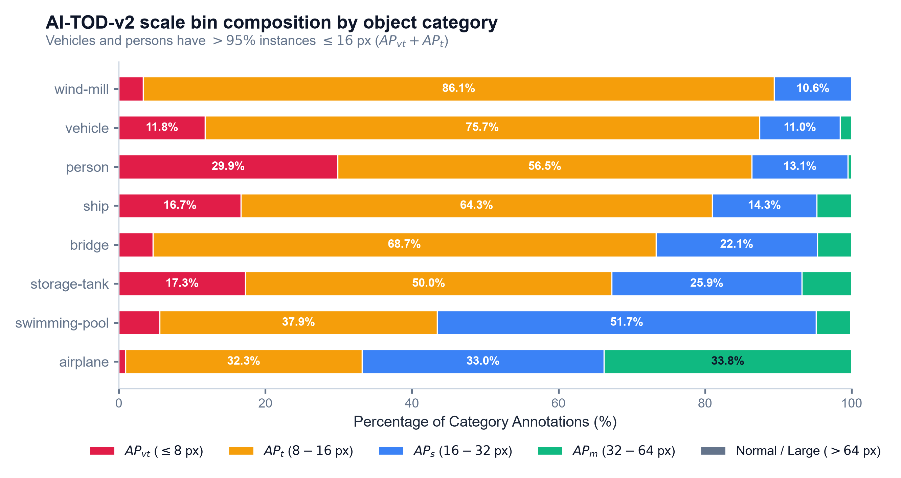
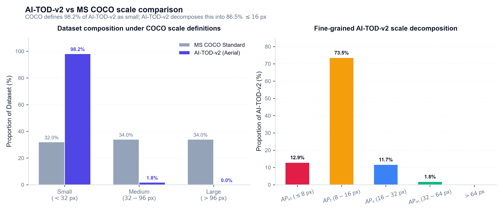

# AI-TOD-v2 exploratory data analysis and scale diagnostic report

**Dataset:** AI-TOD-v2 ($800 \times 800$ aerial imagery, micro-scale targets)  
**Annotations analyzed:** 376,625 instances across 14,018 images (trainval)  
**Splits evaluated:** `aitodv2_train.json` (11,214 images, 301,534 annotations), `aitod_val.json` (2,804 images, 70,424 annotations), `aitodv2_trainval.json` (14,018 images, 376,625 annotations)  
**Tooling/Environment:** Python 3.11, Pandas, NumPy, Matplotlib, Seaborn (`scripts/eda_aitod.py`)  

---

## 1. Executive summary and scale diagnostic findings

- **Extreme micro-scale concentration:** Across the dataset (376,625 annotations in trainval), median object scale $\sqrt{w \times h}$ is **11.83 px** (mean: **12.67 px**). **86.54%** of all targets (325,898 instances) measure $\le 16$ px ($AP_{vt} + AP_t$). In contrast to MS COCO where objects $< 32$ px represent $\sim 32\%$ of instances, **98.20%** (369,816 instances) of AI-TOD-v2 targets fall below 32 px.
- **Downsampling stride feature collapse:**
  - $P_3$ (stride 8): The median 11.83 px object spans only $1.48 \times 1.48$ feature cells. For an 8.0 px object (the $AP_{vt}$ upper bound), spatial representation collapses to a single $1.0 \times 1.0$ cell.
  - $P_4$ (stride 16): The median object collapses to $0.74 \times 0.74$ cells ($< 1$ cell). 8.0 px objects span $0.50 \times 0.50$ cells, causing complete loss of distinctive feature representations.
  - $P_5$ (stride 32): The median object occupies $0.37 \times 0.37$ cells; 8.0 px objects occupy $0.25 \times 0.25$ cells. High-level feature pyramids produce zero distinct activation for microscopic targets.
  - $P_2$ requirement (stride 4): A dedicated $P_2$ high-resolution head yields $2.96 \times 2.96$ cells ($\sim 8.75$ spatial feature elements) for a median 11.83 px target and $2.00 \times 2.00$ cells for an 8.0 px target, preserving local structural gradients and boundaries.
- **Bounding box geometry and aspect ratio:** Object aspect ratios ($w/h$) exhibit a sharp distribution with a median of exactly 1.00 and 25th-75th percentiles between 0.67 and 1.67. Micro targets are overwhelmingly square or isotropic aerial footprints, concentrated in a dense cluster at $w \in [10, 14]$ px and $h \in [10, 14]$ px.
- **Severe category imbalance:** The dataset is heavily dominated by the `vehicle` class, accounting for 87.47% of trainval annotations (329,404 instances). `person` (4.86%) and `ship` (4.76%) form secondary clusters, while classes such as `airplane` (0.22%), `bridge` (0.20%), and `wind-mill` (0.07%) exhibit extreme sparsity.
- **Data sanitization requirement:** The audit identified **40 zero-dimension annotations** in `aitodv2_train.json` ($w \le 0$ or $h \le 0$) and **49** in `aitodv2_trainval.json`. Ingestion and training dataloaders must filter or clamp annotations where $\min(w, h) < 1.0$ px to prevent numerical instability, division by zero, and loss divergence during regression optimization.

---

## 2. Visual diagnostics

### Scale distribution

*Figure 1: Empirical scale distribution ($\sqrt{w \times h}$) in pixels across the AI-TOD-v2 train split. Vertical dashed lines mark AI-TOD evaluation bins ($AP_{vt} \le 8$ px, $AP_t \in (8, 16]$ px, $AP_s \in (16, 32]$ px, $AP_m \in (32, 64]$ px). 86.46% of training instances fall within $AP_{vt}$ and $AP_t$ ($\le 16$ px), with median scale 11.83 px and mean scale 12.72 px.*

### Bounding box geometry and aspect ratio

*Figure 2: Empirical aspect ratio distribution and joint dimension density. Left: Histogram and KDE of aspect ratio ($w / h$), showing a sharp peak at median 1.00. Right: Log-scale 2D hexbin of width versus height, confirming a dense cluster at $w, h \in [10, 15]$ px.*

### Category scale breakdown

*Figure 3: Scale bin composition per object category. Vehicles (87.95% of train annotations) and persons have over 95% instances $\le 16$ px ($AP_{vt} + AP_t$). Spatially extended categories (bridges, swimming pools) exhibit broader representations across $AP_s$ and $AP_m$.*

### Benchmark scale comparison against MS COCO

*Figure 4: Empirical scale comparison between AI-TOD-v2 and MS COCO standard definitions. Left: Dataset breakdown under COCO thresholds ($<32$, $32-96$, $>96$ px), where 98.17% of AI-TOD-v2 is classified as small. Right: Decomposition of AI-TOD-v2 across fine-grained evaluation bins, revealing that 86.46% of instances reside below 16 px.*

---

## 3. Empirical class and scale distribution

### Scale metrics across dataset splits

| Metric | Train split | Validation split | Trainval split |
| :--- | :--- | :--- | :--- |
| **Total images** | 11,214 | 2,804 | 14,018 |
| **Total annotations** | 301,534 | 70,424 | 376,625 |
| **Valid annotations** | 301,494 | 70,424 | 376,576 |
| **Zero-dimension annotations ($w \le 0$ or $h \le 0$)** | 40 | 0 | 49 |
| **Average target density** | 26.89 objs/img | 25.12 objs/img | 26.87 objs/img |
| **Mean scale $\sqrt{w \times h}$** | 12.72 px | 12.63 px | 12.67 px |
| **Standard deviation** | 5.76 px | 5.94 px | 5.75 px |
| **Median scale** | 11.83 px | 11.83 px | 11.83 px |
| **25th - 75th percentile** | 9.80 - 14.14 px | 9.38 - 14.14 px | 9.80 - 14.07 px |
| **5th - 95th percentile** | 6.71 - 22.23 px | 6.00 - 22.45 px | 6.71 - 22.00 px |

### Scale bin distribution

| Scale bin | Range (pixels) | Train count (%) | Validation count (%) | Trainval count (%) |
| :--- | :--- | :--- | :--- | :--- |
| **$AP_{vt}$ (Very Tiny)** | $\le 8$ px | 38,942 (12.92%) | 10,784 (15.31%) | 50,002 (13.28%) |
| **$AP_t$ (Tiny)** | $8 - 16$ px | 221,721 (73.54%) | 49,724 (70.61%) | 275,896 (73.26%) |
| **$AP_s$ (Small)** | $16 - 32$ px | 35,329 (11.72%) | 8,600 (12.21%) | 43,918 (11.66%) |
| **$AP_m$ (Medium)** | $32 - 64$ px | 5,497 (1.82%) | 1,316 (1.87%) | 6,753 (1.79%) |
| **Normal / Large** | $> 64$ px | 5 (0.00%) | 0 (0.00%) | 7 (0.00%) |
| **Micro sub-total ($AP_{vt} + AP_t$)** | $\le 16$ px | **260,663 (86.46%)** | **60,508 (85.92%)** | **325,898 (86.54%)** |
| **COCO Small equivalent** | $< 32$ px | **295,992 (98.17%)** | **69,108 (98.13%)** | **369,816 (98.20%)** |

### Category distribution across splits

| Category | Train count | Train % | Val count | Val % | Trainval count | Trainval % |
| :--- | :--- | :--- | :--- | :--- | :--- | :--- |
| **vehicle** | 265,164 | 87.95% | 59,904 | 85.06% | 329,404 | 87.47% |
| **person** | 14,446 | 4.79% | 3,841 | 5.45% | 18,306 | 4.86% |
| **ship** | 14,072 | 4.67% | 3,791 | 5.38% | 17,911 | 4.76% |
| **storage-tank** | 5,576 | 1.85% | 2,477 | 3.52% | 8,209 | 2.18% |
| **swimming-pool** | 787 | 0.26% | 34 | 0.05% | 899 | 0.24% |
| **airplane** | 666 | 0.22% | 170 | 0.24% | 843 | 0.22% |
| **bridge** | 603 | 0.20% | 140 | 0.20% | 755 | 0.20% |
| **wind-mill** | 180 | 0.06% | 67 | 0.10% | 249 | 0.07% |

---

## 4. Architectural implications

### Feature map stride collapse at P2, P3, P4, and P5

Standard YOLO object detection backbones downsample input imagery across successive feature pyramid network (FPN) stages:
- **P2 (stride 4, $H/4 \times W/4$):** An 11.83 px median object maps to $2.96 \times 2.96$ feature cells ($\sim 8.75$ spatial cells). An 8.0 px object maps to $2.00 \times 2.00$ cells ($4.00$ spatial cells). Boundary gradients and shape context remain recoverable.
- **P3 (stride 8, $H/8 \times W/8$):** The 11.83 px median object maps to $1.48 \times 1.48$ feature cells ($\sim 2.19$ spatial cells). An 8.0 px object maps to exactly $1.00 \times 1.00$ cell. Spatial pooling mixes target pixels with surrounding background texture, causing severe feature blurring.
- **P4 (stride 16, $H/16 \times W/16$):** The 11.83 px median object maps to $0.74 \times 0.74$ cells ($0.55$ cells). An 8.0 px object maps to $0.50 \times 0.50$ cells ($0.25$ cells). The target is sub-pixel relative to the feature map stride, precluding spatial localization.
- **P5 (stride 32, $H/32 \times W/32$):** The 11.83 px median object maps to $0.37 \times 0.37$ cells ($0.14$ cells). P5 features cannot capture micro-scale targets.

Because standard YOLO models (such as YOLOv8s) omit P2 and detect from P3, P4, and P5, they allocate 86.54% of AI-TOD-v2 instances to feature levels where the target spans fewer than two feature cells. Integrating a P2 stride-4 detection head is necessary to preserve spatial resolution.

### IoU sensitivity on micro bounding boxes

For two axis-aligned square bounding boxes of side length $S$ with a 1D spatial displacement of $\Delta x$ pixels ($\Delta x \le S$):

$$\text{Intersection} = (S - \Delta x) \times S, \quad \text{Union} = 2S^2 - (S - \Delta x)S = S(S + \Delta x)$$

$$\text{IoU}(\Delta x) = \frac{S - \Delta x}{S + \Delta x}$$

Under a 2D diagonal displacement of $\Delta x = \Delta y = \delta$:

$$\text{Intersection} = (S - \delta)^2, \quad \text{Union} = 2S^2 - (S - \delta)^2$$

$$\text{IoU}(\delta) = \frac{(S - \delta)^2}{2S^2 - (S - \delta)^2}$$

Empirical consequences for micro targets versus standard targets:
- For a micro target of scale $S = 10$ px:
  - 1-pixel shift ($\delta = 1$): $\text{IoU} = \frac{9^2}{200 - 81} = \frac{81}{119} \approx 0.681$.
  - 2-pixel shift ($\delta = 2$): $\text{IoU} = \frac{8^2}{200 - 64} = \frac{64}{136} \approx 0.471$.
  - A 2-pixel localization deviation causes IoU to drop below the standard 0.50 positive anchor assignment threshold.
- For a standard COCO target of scale $S = 100$ px with the same 2-pixel displacement:
  - 2-pixel shift ($\delta = 2$): $\text{IoU} = \frac{98^2}{20000 - 9604} = \frac{9604}{10396} \approx 0.924$.

Because small spatial errors produce massive IoU drops on micro boxes, standard IoU-based label assigners (such as MaxIoUAssigner and TaskAlignedAssigner) assign zero positive anchors to valid micro targets. This motivates dynamic label assignment (STAL in YOLO26) and distribution-based distance metrics such as Normalized Gaussian Wasserstein Distance (NWD), which maintain smooth non-vanishing gradients across non-overlapping micro boxes.

### Data sanitization requirements

The evaluation identified **40 zero-dimension bounding boxes** in `aitodv2_train.json` ($w \le 0$ or $h \le 0$) and **49** in `aitodv2_trainval.json`.
- Ingestion pipelines converting COCO annotations to YOLO format must drop or clamp boxes where $\min(w, h) < 1.0$ px.
- Unsanitized zero-dimension boxes produce NaN coordinate normalizations ($w_{norm} = 0 / W_{img}$) and infinite regression loss in CIoU, GIoU, and DFL heads during training.
