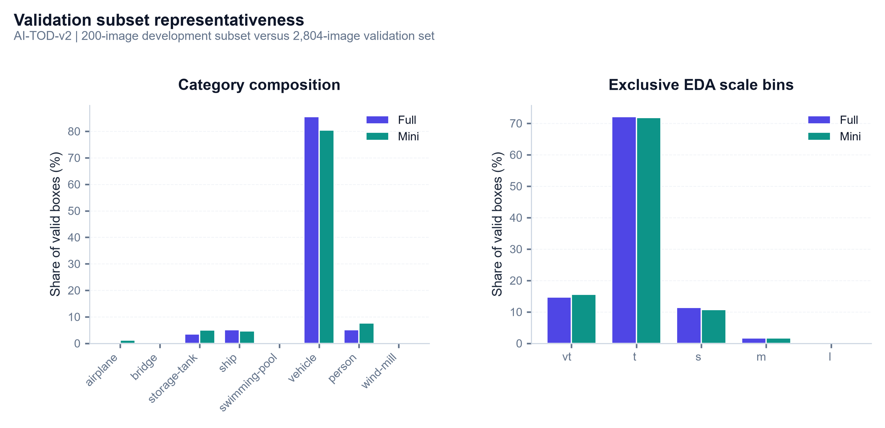
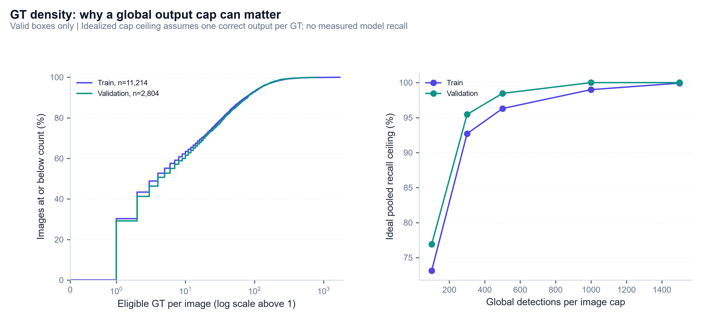
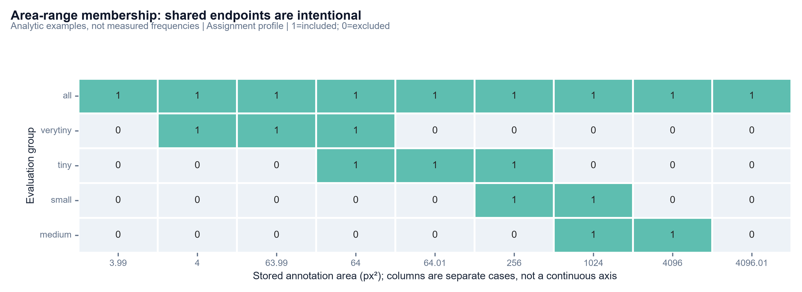

# Phase 1: Evaluation input audit and protocol

**Status:** Complete; figures and analysis expanded after Phase 5. Later implementation is documented in the linked phase reports.

**Date:** 2026-11-01 (Asia/Saigon) | **Dataset:** AI-TOD-v2

**Source revision:** `24825f648a8f425cf99e5a5933b7953c5bb4e661`; this identifies the audited base revision; evaluation additions are maintained on the feature branch.

**Scope:** Input correctness, reproducibility and evaluation settings. **No model accuracy was measured.**

## 1. Objective and implementation

Establish a reproducible evaluation surface for the research question: **how does detection performance change as object size decreases?** Correct inputs and a fixed metric contract are prerequisites for attributing later differences to a model or intervention.

| Artifact | Responsibility |
| :--- | :--- |
| `src/eval/protocol.py` | Named settings, inclusive area membership and a non-mutating ground-truth adapter |
| `src/eval/audit.py` | Schema/geometry audit, exact image hashes, prepared-split coverage, deterministic subset verification, distribution drift and figure export |
| `tests/test_evaluation_protocol.py` | Boundary and input-adaptation regression checks without trained weights |
| `runs/eval/input_audit/` | Ignored local audit JSON, image hash manifest and normalized evaluation ground truth |

The audit streams SHA-256 in 1 MiB chunks, with **four I/O workers**. It reads each raw image once for hashing, checks dimensions, and compares copied mini-validation image bytes against their originals. It does not repeat the previous exhaustive YOLO-row scan or perform model inference. Source annotations and prepared data are unchanged.

The report folder is now **`docs/evaluation/`**, with updated working-plan/index links.

## 2. Audited inputs

| Check | Train | Validation | Interpretation |
| :--- | ---: | ---: | :--- |
| Original images | **11,214** | **2,804** | Every filename and dimension matched the JSON |
| Original annotations | 301,534 | **75,091** | v2 counts reconcile with 376,625 total annotations |
| Eligible positive-dimension/area boxes | **301,494** | **75,082** | Original positive geometry retained |
| Nonpositive boxes | **40** | **9** | Excluded from evaluation copies; source JSON remains intact |
| Boxes extending outside the frame | **736** | **161** | Original coordinates/area retained for evaluation |
| Maximum border overflow | 54 px | 44 px | Not merely numerical noise |
| Annotated area versus bbox area mismatches | **0** | **0** | Checked with relative tolerance 1e-9 and absolute tolerance 1e-6 |
| Crowd / ignore flags set | **0 / 0** | **0 / 0** | No crowd/ignore exclusions in these files |
| Duplicate image IDs, annotation IDs, filenames or stems | **0** | **0** | Image/annotation IDs are unique within each split |
| Maximum annotated objects in one image | **1,729** | **815** | Dense-scene detection caps matter |
| Images with more than 300 valid objects | 89 | **19** | A 300-output global cap can constrain dense-scene recall |

**Split separation:** zero shared filenames and **zero shared SHA-256 image-file hashes**. This establishes no byte-identical image leakage; it does not establish geographic independence or exclude overlapping crops, visually similar scenes, or alternate encodings of the same image.

**Category mapping:** model indices 0–7 map by exact names to original category IDs 0–7: airplane, bridge, storage-tank, ship, swimming-pool, vehicle, person, wind-mill. This numeric equality is an observed property, not a general export rule. Phase 2 must map by class name and reject unsupported vocabularies. Image IDs start at zero and are reused across train/validation; an image ID is meaningful only together with its annotation split.

The validation file contains one strictly sub-1-px side: annotation 53998 has width **0.9999999999999716 px**, effectively 1 px at floating-point precision. It remains eligible. No additional arbitrary minimum-side filter is introduced.

### Immutable source fingerprints

| Annotation JSON | SHA-256 |
| :--- | :--- |
| `aitodv2_train.json` | `ed7b37a1187b496b96943fa46c15aab39656d59eaf501192d85178354b637b2e` |
| `aitod_val.json` | `d0439ba687db66bb38584a3398a906f15c47e055cdd84bb9060496a91f30d7cf` |

The historical EDA validation count **70,424** does not describe this downloaded v2 validation file. Subsequent reports must use the audited source hashes and measured support, rather than reuse that count.

### Ground-truth adaptation

Both annotation files contain an **annotation with ID 0**. COCOeval stores a matched annotation ID in `dtMatches`, where **0 is the unmatched sentinel**. The adapter therefore assigns annotation IDs **1…N** in a copy and preserves the old value in `source_annotation_id`. It preserves **image IDs**, **category IDs**, source area and positive box coordinates, and supplies `info`/`iscrowd` defaults needed by COCO consumers.

YOLO conversion clips out-of-frame boxes, while this evaluation contract retains original positive GT geometry. This training/evaluation difference is intentional and recorded; silently clipping evaluation GT would change the benchmark surface. Degenerate boxes are excluded from the copied evaluation data, including nine from full validation.

## 3. Development-subset representativeness

Re-running the existing selector with **seed 42** exactly reproduced both saved ID lists. All prepared full/mini image and label sets matched their expected source selections. The development set contains **1,000 training / 200 validation images**, with 24,877 / 5,054 valid boxes; full validation contains 75,082 eligible boxes. No regeneration was needed.

**Drift** below means mini share minus full share, measured in **percentage points (pp)** over valid annotated objects, not image proportions or AP.

### Validation category support

| Category | Full boxes | Mini boxes | Full share | Mini share | Drift (pp) |
| :--- | ---: | ---: | ---: | ---: | ---: |
| **airplane** | 177 | 64 | 0.236% | 1.266% | +1.031 |
| **bridge** | 152 | 21 | 0.202% | 0.416% | +0.213 |
| **storage-tank** | 2,633 | 253 | 3.507% | 5.006% | +1.499 |
| **ship** | 3,839 | 235 | 5.113% | 4.650% | -0.463 |
| **swimming-pool** | 112 | 10 | 0.149% | 0.198% | +0.049 |
| **vehicle** | 64,240 | 4,065 | 85.560% | 80.431% | -5.128 |
| **person** | 3,860 | 391 | 5.141% | 7.736% | +2.595 |
| **wind-mill** | 69 | 15 | 0.092% | 0.297% | +0.205 |

All eight classes occur in both splits, but minority-class boosting changes object frequencies. In particular, vehicle share falls **5.128 pp**, while person rises **2.595 pp** and storage-tank rises **1.499 pp**. Sparse mini classes still have few instances: swimming-pool has **10**, and wind-mill **15**. Class-specific estimates may therefore be unstable.

### Validation scale support: exclusive EDA groups

| Group | Full boxes | Mini boxes | Full share | Mini share | Drift (pp) |
| :--- | ---: | ---: | ---: | ---: | ---: |
| **vt** | 11,060 | 789 | 14.731% | 15.611% | +0.881 |
| **t** | 54,175 | 3,633 | 72.154% | 71.884% | -0.271 |
| **s** | 8,589 | 545 | 11.439% | 10.784% | -0.656 |
| **m** | 1,256 | 86 | 1.673% | 1.702% | +0.029 |
| **l** | 2 | 1 | 0.003% | 0.020% | +0.017 |

Here scale is $s=\sqrt{wh}$: **vt** $0<s\le8$, **t** $8<s\le16$, **s** $16<s\le32$, **m** $32<s\le64$, **l** $s>64$ px. The combined $s\le16$ share is **86.885% full** versus **87.495% mini**. Scale composition is closer than category composition; maximum absolute scale-share drift is **0.881 pp**.

The training mini split also drifts: vehicle share **−5.448 pp**, person **+3.015 pp**, and the combined micro share **84.874% mini** versus **86.457% full**. These findings measure the existing selector's outcome, not exact stratification.

**Decision:** retain the deterministic mini set for development and controlled smoke comparisons. Use the fixed **full validation set** for final benchmarks; do not present mini and full scores as interchangeable.

## 4. Frozen evaluation protocol

`evaluation_protocol("assignment")` is the default, named **`aitod-assignment-v1`**. `evaluation_protocol("upstream")` is a separately named **range-compatible reference profile**, not a claim that all published evaluation details are reproduced.

| Setting | Frozen value / rule |
| :--- | :--- |
| Evaluation surface | Bounding boxes in original-image pixel coordinates; original image/category IDs |
| All-area range | $[0,10^{10}]$ px² |
| Assignment vt / t / s / m | $[4,64]$, $[64,256]$, $[256,1024]$, $[1024,4096]$ px² |
| Reference vt / t / s / m | $[0,64]$, $[64,256]$, $[256,1024]$, $[1024,10^{10}]$ px² |
| Interval endpoints | **Inclusive on both sides**, matching COCOeval; no rounding or added epsilon |
| IoU thresholds | **0.50, 0.55, …, 0.95** |
| Recall sampling | **101 points**, 0.00–1.00 |
| Matching | Category-aware, with evaluator crowd/ignore semantics |
| Evaluator `maxDets` | **[1, 100, 1500]** per image/category under COCOeval |
| Prediction export | Confidence floor **0.001**, requested global cap **1,500/image** |
| Native input size / augmentation | **800 px** / test-time augmentation disabled |
| YOLOv8 postprocessing | Class-aware NMS, IoU **0.70** |
| YOLO26 postprocessing | Native end-to-end output; record and verify effective head top-k and export cap |
| Fixed operating point | Score **0.25**; IoU **0.50**, plus separate mean over 0.50:0.05:0.95 |
| Aggregate AP | Mean over eligible category/IoU/recall tensor entries; exclude unsupported `−1` entries |
| Display | AP and precision/recall in percent; differences in **percentage points** |

The pinned reference is [AI-TOD COCOeval, revision 44a230ae5197cb89bf9e5e62f313cac3ad30c7af](https://github.com/jwwangchn/cocoapi-aitod/blob/44a230ae5197cb89bf9e5e62f313cac3ad30c7af/aitodpycocotools/aitodpycocotools/cocoeval.py), source SHA-256 `2c3f84612f448dccf085c72f20711f5fb8dcac3022e8f24cdf04af283a24fa1e`. Its bounds and detection settings were read from that exact source.

**COCO range support is not a partition.** At area 64, for example, a GT box belongs to both vt and t. Using source areas and strict inclusive comparisons, full validation has support **10,997 vt / 54,720 t / 8,880 s / 1,262 m**; mini validation has **786 / 3,670 / 565 / 89**. These counts differ from the exclusive EDA table and must not be summed as unique objects. Positive objects outside the assignment bins remain in **all**. Floating-point areas near a boundary are compared as stored, without rounding.

**Detection-cap limitation:** the export cap is global per image, whereas COCOeval applies its cap per image/category. YOLO26's installed head has a default top-k of 300; passing an external cap alone must not be assumed sufficient. Phase 2 must verify the effective internal cap and log cap hits. Increase both models' effective caps together or explicitly version any necessary protocol change. A confidence floor of 0.001 approximates a complete ranking; truncation sensitivity still needs prediction-based verification.

### Precision/recall definitions

At each score/IoU operating point, derive **TP, FP, FN** from evaluator matches and ignore flags. Primary summaries are pooled **micro** values: $P=\sum TP/\sum(TP+FP)$ and $R=\sum TP/\sum(TP+FN)$. Report class-wise results and secondary macro means over categories with eligible GT. For supported classes with no predictions, macro precision is defined as zero; classes without GT are **N/A** and excluded from the macro mean. A pooled zero denominator is **N/A**. For size-specific precision, respect evaluator treatment of ignored matches and unmatched detections outside the area range.

For the 0.50:0.95 operating-point summary, compute precision/recall separately at each IoU, then average the defined values. This is **not COCO AR**: AR summarizes maximum recall from the low-confidence ranked detections and prescribed detection cap. Thresholds were fixed before observing any model accuracy; no final-validation threshold tuning was performed.

## 5. Three visual checks and their practical interpretation

### Figure 1 - Similar size composition can hide a class-composition shift



The panels compare **valid-object shares**, not detector scores. Full/mini scale shares are fairly close: the largest absolute scale drift is **0.881 pp**, and the combined scale-at-most-16-px share changes from **86.885% to 87.495%**. Category shifts are larger: vehicle falls **5.128 pp**, person rises **2.595 pp**, and storage-tank rises **1.499 pp**.

The distinction matters because a tiny-object slice can contain a different mixture of classes and contexts after subset selection. Even with all eight classes present, the mini set has only **10 swimming-pool** and **15 wind-mill** instances. Presence alone does not make class-specific estimates stable. COCO AP weights supported categories equally, whereas pooled operating recall weights individual GT through their counts.

**Similar scale shares + changed class support** $\implies$ **a useful development set, with no guarantee of representative full-validation accuracy**. Keep paired smoke comparisons on these exact 200 IDs; use all 2,804 validation IDs for final conclusions. Do not compare mini/full AP as if only the number of images changed.

### Figure 2 - Rare dense scenes can dominate a global cap's cost



The left empirical CDF gives the **fraction of images** with at most a given valid-GT count. The count axis is linear near zero and logarithmic above one, so all images remain represented, including **10 train images with zero eligible GT** (validation has none). The two curves largely overlap through typical scenes, while train has a longer dense tail. The right panel instead weights **objects**, calculating an ideal upper ceiling for a hypothetical perfect detector with a global cap $C$:

$R_{ceiling}(C)=\sum_i\min(N_i,C)/\sum_i N_i$, where $N_i$ is eligible GT in image $i$.

| Global cap | Train images above cap | Train unavoidable misses | Train ideal ceiling | Validation images above cap | Validation unavoidable misses | Validation ideal ceiling |
| ---: | ---: | ---: | ---: | ---: | ---: | ---: |
| **100** | 769 | 81,021 | 73.13% | 201 | 17,349 | 76.89% |
| **300** | 89 | 22,002 | 92.70% | 19 | 3,412 | 95.46% |
| **1,500** | 1 | 227 | 99.92% | 0 | 0 | 100.00% |

Only **19/2,804 validation images (0.68%)** exceed 300 valid GT, yet their overflow is **3,412 objects**, or **4.54%** of the validation total. Thus an apparently small image-tail frequency can still matter for object recovery. The largest valid-GT counts are **1,727 train / 815 validation**; the earlier audit's raw train maximum of **1,729** includes invalid annotations, so these are deliberately different quantities.

A cap of 1,500 has no GT-density-imposed loss on this validation set in this idealized calculation. It does **not** imply actual recall 100% or no model truncation: false positives, ranking, class filtering, native head top-k and confidence filtering still consume or remove candidates. The evaluator cap is per image/category, while this calculation is about a **global image-output cap**. No model prediction or training behavior is measured here; train density is contextual, not a train-evaluation recommendation.

**A thin image tail with many objects** $\implies$ **check both image-level cap hits and object-level sensitivity**. For P2/SAHI collaborators, keep the agreed cap and inspect merged output density before attributing recall changes to the architecture or slicing.

### Figure 3 - Closed micro bins overlap at their boundaries



This is an **analytic contract diagram**, not a frequency heatmap. At **64 px²**, both verytiny and tiny include the object; at **256**, tiny/small overlap; at **1,024**, small/medium overlap. A **3.99 px²** positive object remains in all but outside assignment vt, whereas **4 px²** enters vt. A **4,096.01 px²** object remains in all but outside assignment medium.

These cases explain why the exclusive EDA histogram and evaluator support differ without a counting bug: mini exclusive EDA counts are **789/3,633/545/86**, while the assignment evaluator reports **786/3,670/565/89**. The difference is not simply an offset from shared endpoints: the assignment lower vt bound excludes positive areas below four, and areas are compared **as stored**. Rounding floating-point areas before evaluation could move objects across a boundary and change an AP denominator.

**Closed interval membership** $\implies$ **four diagnostic populations, not a partition of all GT**. Never sum micro-bin support as unique objects, assign each evaluator object to exactly one EDA bin, or average the four bin APs to reconstruct overall AP. Use the named protocol rather than rewriting its thresholds in a teammate's code.

All three figures reuse project typography, headers, palettes, clean axes and **300-dpi** export. The added figures use existing audited annotation hashes and saved metadata; no full image hashing or inference was rerun. The numerical density summary is retained in ignored `runs/eval/phase12_visual_diagnostics.json`; reusable plotting functions live in `src/eval/plots.py`.

## 6. Verification and reproducibility

```powershell
. .venv/Scripts/Activate.ps1
python -m unittest discover -s tests -v
python -m src.eval.audit
```

| Check | Actual result |
| :--- | :--- |
| Three contract test methods | **Passed**: shared boundaries and adjacent floating-point values; independent protocol instances and invalid names; non-mutating selection/invalid-box removal/positive annotation IDs |
| Real-data schema and geometry audit | **Passed**, with explicitly recorded nonpositive/out-of-frame cases |
| Original annotation hashes | **Unchanged**, matched preparation provenance |
| Raw imagery checks | All **14,018** filenames/dimensions checked and complete image bytes SHA-256 hashed |
| Cross-split exact-image leakage | **0 filename overlaps, 0 content-hash overlaps** |
| Mini selection reproducibility | Both ordered ID lists reproduced with seed 42 |
| Normalized evaluation inputs | Full: **2,804 images / 75,082 GT**; mini: **200 images / 5,054 GT**; annotation IDs positive and unique |
| Ruff checks | **Passed** for new evaluation modules and contract tests; formatted consistently |
| Figure export | Initial Tk backend failure corrected with **Agg**; saved figure regenerated from the completed audit and visually checked |

Environment: **Python 3.12.14**, PyTorch **2.14.1+cpu**, Ultralytics **8.4.184**, NumPy **2.5.4**, Pillow **13.0.0**. Audit execution is CPU-only and does not invoke a model. Code fingerprints and source revision are recorded in the local audit JSON. The raw data audit completed before the plotting-backend failure; only plotting was rerun after that fix, avoiding an unnecessary repeat of the full image hash scan.

Local reusable outputs: `audit.json`, `image_hashes.json`, `val_ground_truth.json`, and `mini_val_ground_truth.json` under **`runs/eval/input_audit/`**. They are ignored by Git. Required selected image IDs and seed remain in `data/ai-tod-v2/preparation_summary.json`; source files remain separate from large dataset artifacts.

## 7. Limits and next-phase gate

**Checkpoint status at the original Phase 1 completion:** no local `.pt` files were found in `weights/`, `runs/train/`, or `runs/kaggle/`. Member 1's pending-checkpoint handoff remains the source of expected future artifacts; no remote run status was inferred or rechecked. Checkpoint hashes and training provenance will be recorded upon arrival. No AP, PR curve or model failure example has been fabricated.

Phase 1's input/protocol gate is complete. The subsequent [Phase 2 report](02_prediction_export.md) documents the implemented COCO prediction export using analytic fixtures or clearly labeled pretrained smoke predictions while trained checkpoints are pending. It verifies class-name mapping, original coordinate recovery, zero-prediction image coverage and effective detection caps. Final benchmark conclusions remain dependent on genuine trained-model predictions.
