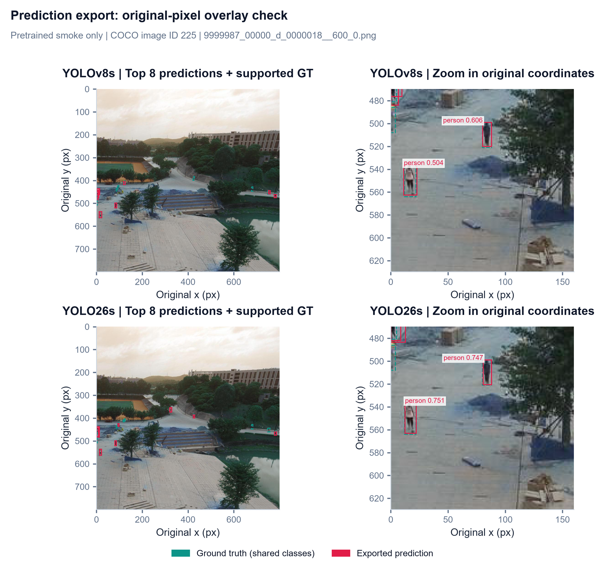
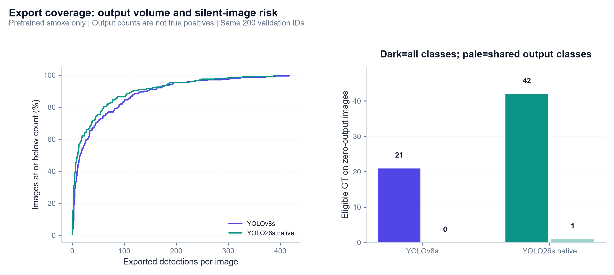
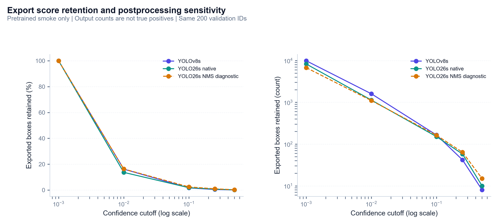

# Phase 2: COCO prediction export and validation

**Status:** Complete; export diagnostics and analysis expanded after Phase 5. Evaluator/CLI implementation is covered in the later reports.

**Date:** 2026-11-01 (Asia/Saigon)

**Scope:** Correct prediction serialization, source identity, coordinate recovery and reproducible inference metadata. **All real-model runs are pretrained smoke tests; no AI-TOD accuracy benchmark was measured.**

## 1. Objective and implementation

Produce reusable COCO result JSON while preserving the exact image selection needed by size-based evaluation. In particular, **an image with no predictions must remain in the evaluation denominator**.

| Artifact | Responsibility |
| :--- | :--- |
| `src/eval/export.py` | Exact-name category mapping, original-pixel conversion, bounded-batch inference, streaming JSON and complete-image manifest |
| `src/eval/plots.py` | Regenerate context/zoom overlays from saved predictions with existing project styling |
| `tests/test_prediction_export.py` | Export regression checks, including empty outputs, copied inference backends and rectangular letterboxing |
| `runs/eval/phase2_*_smoke/` | Ignored prediction JSON and completed manifest for each intended model run |

The installed Ultralytics validator's `pred_to_json()` derives an image ID from the filename stem. AI-TOD IDs must instead come from its annotation JSON. The adapter therefore uses **resolved full source path → annotation image record → original image ID**. Distinct nested files such as `a/42.png` and `b/42.png` remain distinct even though their stems match. Repeated resolved paths, missing files, duplicate/unknown selected IDs, and paths outside the image root are rejected.

Only an existing native **`.pt` detection checkpoint** is accepted. Missing trained checkpoints do not cause a silent fallback to pretrained weights.

## 2. Prediction and identity contract

Each result row contains exactly:

```json
{"image_id": 91, "category_id": 17, "bbox": [64.0, 32.0, 128.0, 64.0], "score": 0.75}
```

This row is an **analytic test example**, not an AI-TOD model measurement. `bbox` is top-left **[x, y, width, height]** in original-image pixels. No coordinate/confidence rounding is introduced during serialization.

| Check | Implemented behavior |
| :--- | :--- |
| Model index versus dataset category | Map by **exact class name** to original category ID; never assume equal indices |
| Normal evaluation mode | Require the complete exact dataset vocabulary; reject unknown/missing/duplicate class names |
| Explicit pretrained smoke mode | Select shared exact names only and label output **`smoke_only`** |
| Image identity | Use original JSON IDs, including ID **0**, not filename numbers or iteration positions |
| Coordinates | Consume `Results.boxes.xyxy`, already restored by the detection predictor to original pixels |
| Geometry and score | Reject non-finite values, unmapped classes, non-integral class indices, zero/negative dimensions, out-of-frame predictions and scores outside [0,1] |
| Image coverage | Require exactly one result per selected path; reject omitted, repeated or unexpected paths |
| Empty detections | Write a valid **`[]`** if the entire run is empty; retain every selected ID in the manifest |
| Existing output | Refuse overwrite; select a fresh run directory |

The adapter does **not** rescale an original-coordinate `Results` box again. The installed detection predictor calls `scale_boxes()` before constructing `Results`; this was checked against the local 8.4.184 source and the [Ultralytics prediction API](https://docs.ultralytics.com/modes/predict/).

The rectangular regression case uses a **640×320** original image letterboxed to **800×800**: gain **1.25** with **200 px vertical padding**. Input box `[80,240,240,320]` recovers original XYXY `[64,32,192,96]`, and exports XYWH **`[64,32,128,64]`**. This checks nontrivial resize/padding arithmetic rather than relying only on 800×800 images.

## 3. Inference settings and detection-cap findings

The Phase 1 protocol remains unchanged: **800 px**, export confidence **0.001**, requested maximum **1,500 detections/image**, IoU **0.70** for class-aware NMS, fixed square letterboxing (`rect=False`), no augmentation, seed argument 42. Runs used **CPU**, **batch size 4**, and **eight PyTorch threads**, with Python 3.12.14, PyTorch 2.14.1+cpu and Ultralytics 8.4.184.

### Critical integration correction

The installed default configuration has **`nms=None`**, selecting external NMS. Merely loading a YOLO26 dual-head checkpoint does not activate its end-to-end head. The exporter now detects the presence of the one-to-one head and explicitly requests **`nms=False`** for that model; YOLOv8 retains class-aware NMS.

Ultralytics also constructs a **separate active inference backend**. Its detection head must be inspected through `model.predictor.model.model.model[-1]`, rather than the original checkpoint object. In the diagnostic, the original object still showed an inactive head capped at 300, while the live backend had end-to-end mode enabled and **`max_det=1500`**. The final exporter verifies the live head and fails if native mode is not enabled or the internal cap is too low.

An initial YOLO26 external-NMS run was retained under **`runs/eval/phase2_yolo26s_nms_diagnostic/`**: 6,776 detections, five zero-output images, maximum 311/image. It is a **mode diagnostic**, not the intended native-head output. A failed native-mode guard attempt published no completed manifest and its partial prediction file was removed. The corrected native run below completed successfully.

**Output-cap hits** count final retained detections reaching 1,500. Zero hits do not prove that no earlier ranking limit or confidence filtering discarded candidates, particularly with smoke-mode class filtering. Final trained runs still require detection-cap/confidence sensitivity checks. The evaluator's per-image/category cap and the exporter's global per-image cap remain distinct, as defined in Phase 1.

## 4. Real-image smoke export results

Official COCO-pretrained weights were downloaded through Ultralytics from release **`v8.4.0`**. Both checkpoints have **80 classes**. Only **person** and **airplane** exactly match AI-TOD names:

| COCO model index | Name | AI-TOD category ID |
| ---: | :--- | ---: |
| 0 | **person** | **6** |
| 4 | **airplane** | **0** |

The other 78 model classes are explicitly excluded in smoke mode. No alias such as boat→ship or car→vehicle was introduced. Ground truth still describes the full dataset; these outputs therefore cannot establish an eight-class AI-TOD baseline.

Both intended runs processed the **same 200 audited mini-validation image IDs**.

| Model | Selected images | Exported detections | Zero-output images | Maximum detections/image | Output-cap hits | Active postprocessing |
| :--- | ---: | ---: | ---: | ---: | ---: | :--- |
| **yolov8s** | 200 | 9,911 | 4 | 417 | 0 | class_aware_nms |
| **yolo26s** | 200 | 8,299 | 12 | 393 | 0 | native_end_to_end |

YOLOv8's zero-output image IDs are **202, 371, 599, 615**. YOLO26's are **102, 202, 371, 415, 570, 599, 615, 828, 1552, 1744, 1823, 2545**. These IDs remain present in their manifests. **Zero-output image is not synonymous with empty ground truth**; omitting it from evaluation would conceal missed detections.

The live YOLO26 head limit was **1,500** throughout the intended run. Every serialized prediction has a finite positive original-pixel box within the image, a score in **[0.001,1]**, and category ID **0 or 6**. Independent reload checks matched every per-image count, selected ID, weight hash, annotation hash and prediction hash.

Recorded export-loop durations were **145.93 s YOLOv8s** and **75.95 s native YOLO26s**. These include prediction setup/warmup, inference and serialization, exclude checkpoint loading and final fingerprinting, and are **not standardized latency/throughput benchmarks**. No model ranking is inferred from these timings, output counts or confidence scores.

### Checkpoint fingerprints

| File | SHA-256 |
| :--- | :--- |
| `yolov8s.pt` | `1f47a78bf100391c2a140b7ac73a1caae18c32779be7d310658112f7ac9aa78a` |
| `yolo26s.pt` | `646f8bc3fe0a656803d95c294f7852321748cb29d13466a1af8862e2db384a1b` |

Each manifest preserves the exporter source fingerprint used for that run. The first completed YOLOv8 smoke run predates the YOLO26 backend-selection correction; its standard-NMS branch was unchanged, and its saved predictions passed independent validation. Its producer fingerprint is retained rather than replaced by the later code fingerprint.

## 5. Three complementary export visualizations and analysis

### Figure 1 - Context and original-coordinate overlays



Both intended runs show the **same image and crop**, COCO image ID **225**, `9999987_00000_d_0000018__600_0.png`. Selection is deterministic: use the image containing the highest-confidence retained prediction across both runs. Rose boxes are up to eight highest-scoring predictions per model; dashed teal is GT from shared classes. The JSON retains all exported predictions, not only these eight.

The visible person boxes lie near annotated people, while their extents differ. Agreement between full context and zoom supports the original-coordinate overlay check; it would be visibly broken by rescaling `Results.xyxy` a second time or omitting letterbox padding recovery. However, a selected square image cannot prove the rectangular transform is correct; the **640x320 to 800x800 analytic regression** in Section 2 tests that nontrivial case separately.

**Correct placement on the original image** $\implies$ **a useful coordinate sanity check**, not measured localization accuracy. Only subsequent GT matching can establish AP or identify which shown boxes qualify. This selected image and score ranking do not estimate population precision, and scores are not directly calibrated between models.

### Figure 2 - Output-load distribution and GT on silent images



The left CDF compares per-image output counts; its y axis is the percentage of selected images at or below a count. The right panel counts **eligible GT on images with zero exported detections**, separating all classes from the two shared output classes.

| Diagnostic | YOLOv8s | Native YOLO26s | Meaning |
| :--- | ---: | ---: | :--- |
| Zero-output images | 4/200 (2%) | 12/200 (6%) | All must remain in the manifest/evaluation set |
| Median detections/image | 15.5 | 10.0 | Fractional median comes from the middle two image counts |
| 75th percentile | 63.25 | 48.25 | Most images have far fewer outputs than the maximum |
| 95th percentile | 193.10 | 186.10 | The output tail is much heavier than a typical image |
| Eligible GT on zero-output images | 21 | 42 | Full-task denominator lost if those images were omitted |
| Shared-class GT on zero-output images | 0 | 1 | Most silent-image GT belongs to smoke-excluded classes |

The native CDF is generally above/left of v8 through the lower and middle count ranges: a greater fraction of native images have few outputs. Both still have a heavy tail, with maxima **417/393**, so a median alone understates storage/matching load. These counts are post-filter outputs, not counts of unique correct targets.

The coverage panel adds an important qualification. V8's silent images contain **21 GT**, but none from person/airplane; native's contain **42 GT**, including **one shared-class GT**. It would therefore be wrong to label all 21/42 as a failure to recognize the two supported smoke classes. Conversely, restricting evaluation to nonempty prediction images would remove real annotated targets from the full eight-class task: **0.42% / 0.83%** of all 5,054 mini GT disappear from the respective denominator. That changes the experiment and can bias results; the direction of AP change is not guaranteed for every slice.

**A valid empty prediction is still a valid evaluated image** $\implies$ **retain exact selected IDs independently of JSON rows**. For inference/SAHI owners, do not construct evaluation IDs from "images that produced a box" or treat zero outputs as a failed export. A missing result object is an exporter error; a returned empty result is legitimate data.

### Figure 3 - Confidence filtering can reverse raw-volume ordering



The left panel shows the percentage of each export retained above a cutoff; the right uses **absolute retained counts with a logarithmic y axis**. Both x axes are logarithmic. Each model is normalized to its own output count at .001 on the left, so similar retention percentages need not imply the same count. These are empirical score distributions, not precision/recall curves.

| Score cutoff | v8 retained boxes | Native 26 retained boxes | 26 NMS diagnostic boxes |
| ---: | ---: | ---: | ---: |
| **.001** | 9,911 | 8,299 | 6,776 |
| **.01** | 1,604 | 1,134 | 1,104 |
| **.10** | 165 | 151 | 163 |
| **.25** | 42 | 58 | 64 |
| **.50** | 8 | 10 | 15 |

**Most exported boxes lie in the low-score tail.** Raising the cutoff from .001 to .01 retains only **16.18% v8 / 13.66% native**. At .25, only **0.42% / 0.70%** of the original outputs remain. Exporting only .25 boxes would remove most of the ranking used to compute AP. The low floor preserves evidence for evaluation; it is not a recommendation to display every low-score box in an application.

**Raw-volume ordering reverses.** V8 has **1,612 more** outputs at .001, but **16 fewer** at .25. Thus a statement such as "more boxes means better recovery" depends on the cutoff even before matching GT. The retained high-score counts do not identify true positives, and a model's confidence scale need not be calibrated against another model's.

**Postprocessing mode changes the score/count profile too.** Native 26 has **8,299** outputs versus the same-checkpoint external-NMS diagnostic's **6,776**, but at .25 it has **58 versus 64**. Native's larger low-score output set is not simply a uniform increase across thresholds. This comparison records a backend-selection diagnostic, not a trained architecture ablation or accuracy improvement. The diagnostic is drawn dashed and remains excluded from intended baseline comparisons.

**Fixed export floor + recorded active postprocessing** $\implies$ **comparisons with an explicit prediction surface**. Preserve the low-score JSON, vary operating thresholds only in analysis, and record tile merging/NMS/native-head settings for any inference intervention. Matching, localization requirements and support must be examined before attributing a retained-count change to model quality.

All three saved figures were visually checked and reuse project typography, headers, palettes and **300-dpi** saving. Added diagnostics consume saved exports/manifests and exact GT rather than repeating inference. Raw supporting counts are stored in ignored `runs/eval/phase12_visual_diagnostics.json`; plotting code remains in the existing `src/eval/plots.py`.

## 6. Output artifacts and verification

Each intended run directory contains:

| File | Contents |
| :--- | :--- |
| `predictions.json` | Standard COCO result array, streamed without retaining all detections in memory |
| `manifest.json` | Completion marker; purpose, complete image ID/filename list, category mapping/exclusions, per-image/zero/cap counts, settings, active head limits, device, threads, versions, duration, revision and SHA-256 fingerprints |

Input batches are bounded to four images rather than loading the whole validation collection. Per-image rows are written to `predictions.json.part`; the final filename is published only after full image coverage passes. **Consumers must require a completed manifest** as well as the predictions file. Failed prediction runs remove their partial file; committed exports are never overwritten.

| Verification | Result |
| :--- | :--- |
| Contract suite | **7 test methods passed**: three Phase 1 and four export methods with multiple subcases |
| IDs and class mapping | Reordered/noncontiguous category IDs, image ID zero, numeric/duplicate stems, exact-name matching and partial smoke mapping passed |
| Rectangular letterbox case | Exact original-coordinate XYWH result passed |
| Invalid output handling | Non-finite score, out-of-frame/degenerate box and unknown class rejected |
| Coverage and empty output | Empty complete JSON accepted; omitted images rejected; partial files cleaned |
| Live-backend regression | Separate active model/head inspected correctly; inactive or 300-limited native heads rejected |
| Full mini smoke exports | **200/200 image IDs** preserved for both models; JSON schema/counts/bounds/fingerprints independently verified |
| Style and figures | Ruff checks/format checks passed; final overlay visually inspected |

Reproduce on a **fresh output directory** after Phase 1 data preparation:

```python
from pathlib import Path
import torch
from src.eval.export import export_predictions

torch.set_num_threads(8)
for name in ("yolov8s", "yolo26s"):
    export_predictions(
        weights=Path(f"weights/pretrained/{name}.pt"),
        annotations=Path("runs/eval/input_audit/mini_val_ground_truth.json"),
        image_root=Path("data/ai-tod-v2/splits/mini/images/val"),
        output_dir=Path(f"runs/eval/{name}_smoke_repeat"),
        smoke=True, device="cpu", batch_size=4,
    )
```

For actual eight-class checkpoints, pass their genuine `.pt` paths and leave **`smoke=False`**, the default. Their training provenance still needs recording when Member 1 supplies them. The implemented `sod eval run` CLI is documented in [Phase 4](04_cli_and_baselines.md); use it for the current end-to-end interface.

## 7. Completion gate and remaining limits

**Phase 2 is complete:** a reusable export adapter, explicit mapping, original coordinates, complete-image manifests, real smoke outputs, regression tests and visual evidence are available. Required large artifacts and downloaded weights remain ignored by Git. Temporary test directories and failed partial exports were cleaned; no one-off checking script was retained.

**Subsequent implementation:** [Phase 3](03_evaluator_validation.md) implements the micro-scale evaluator, empty-JSON handling, AP/AR/PR and fixed-confidence counts. [Phase 5](05_analysis_and_handoff.md) supplies reusable comparison and failure-example tools. This Phase 2 report remains focused on export behavior; its score/count figures do not establish accuracy. Final trained-model benchmarking remains dependent on Member 1's checkpoint handoff.
