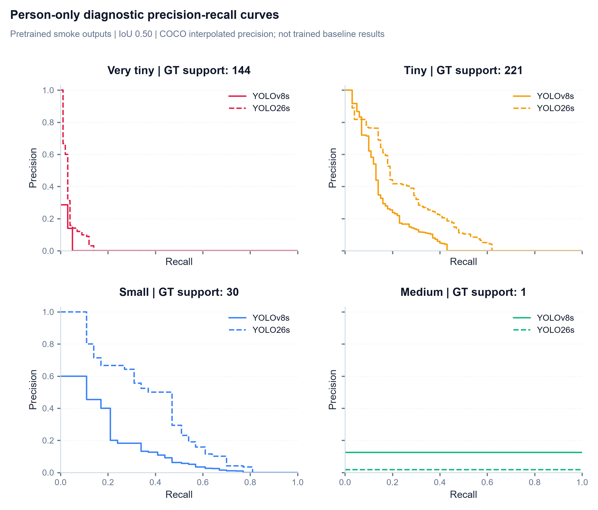
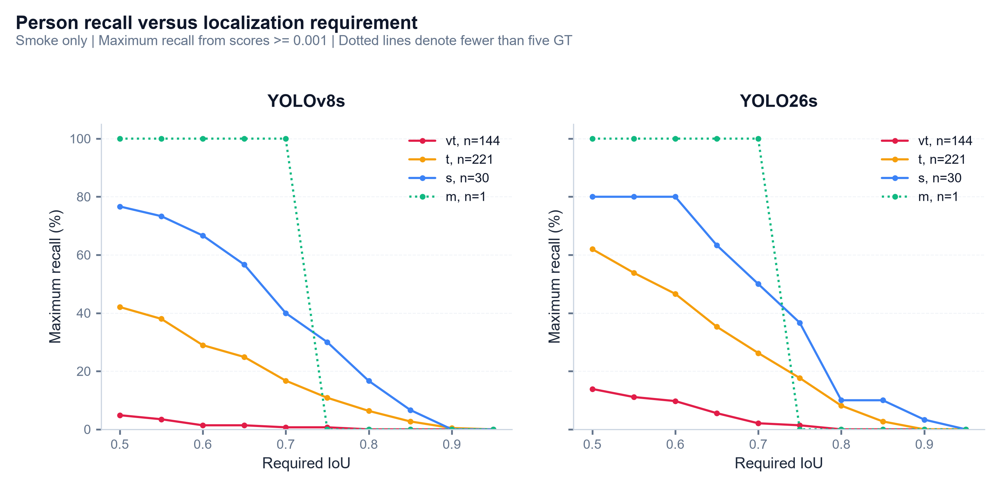
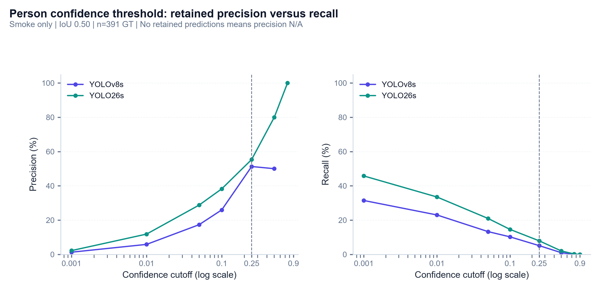

# Phase 3: Micro-scale COCO evaluator and validation

**Status:** Phase 3 complete. Section 5 expanded during Phase 4 review; current integration status is in the [Phase 4 report](04_cli_and_baselines.md).

**Date:** 2026-11-01 (Asia/Saigon)

**Scope:** Metric implementation and correctness. All real-image results below use the previously labeled **pretrained smoke predictions**, not AI-TOD-trained baseline checkpoints.

## 1. Objective and implementation

Implement one reusable evaluator that preserves COCO matching semantics while exposing **AI-TOD micro-scale AP**, **recall**, **per-class results**, **precision–recall data** and **fixed-confidence operating points**.

| Component | Completed work |
| :--- | :--- |
| `src/eval/coco_eval.py` | Input validation, COCO wrapper, tensor summaries, fixed-confidence TP/FP/FN, optional-manifest verification and output serialization |
| `src/eval/protocol.py` | Preserve original source annotation IDs through repeated normalization; use COCO-compatible numerical threshold grids |
| `src/eval/plots.py` | Person-specific micro-bin PR diagnostic from saved tensors |
| `tests/test_coco_evaluation.py` | Ten analytic/serialization test methods, plus existing Phase 1–2 regression tests |
| `pyproject.toml`, `uv.lock` | Explicit dependency **pycocotools 2.0.11** |

The wrapper delegates IoU computation, score ordering, greedy matching, crowd handling, size-ignore masks and PR accumulation to **COCOeval**. It does not implement a competing matcher or rely on the standard hard-coded `summarize()` statistic positions.

Only **pycocotools 2.0.11** was added to the package-version set; no previous package version was removed or upgraded. The newer uv executable normalized lockfile revision/marker formatting, explaining changes beyond the new dependency block. `uv sync --locked` succeeded with **89 installed packages**.

## 2. Evaluation contract

| Output | Definition |
| :--- | :--- |
| **AP** | Mean interpolated precision over IoU 0.50:0.05:0.95, 101 recall points and eligible categories |
| **AP50 / AP75** | Same precision summary restricted to IoU 0.50 / 0.75 |
| **APvt / APt / APs / APm** | AP restricted to assignment area intervals [4,64], [64,256], [256,1024], [1024,4096] px² |
| **AR** | Mean category/IoU maximum recall at the requested detection cap; default **1,500 per image/category** |
| **AR by cap** | Separate recall summaries for **1, 100 and 1,500** |
| **Per-class × size** | AP, AP50, AR, eligible GT support and fixed-confidence counts |
| **PR arrays** | Precision, recall and confidence-at-recall tensors, plus axis labels and threshold grids |
| Unsupported AP/AR | COCO `−1` entries are excluded; empty eligible slices become **Python None / JSON null / report N/A** |
| Supported but undetected GT | **AP=0, AR=0**, rather than N/A |

Shared area endpoints remain inclusive. A box with area 64 can contribute to **both vt and t**; supports across those groups must not be added as unique objects. Explicit floating-point neighbors of 4, 64, 256, 1024 and 4096 were tested through the actual evaluator, using the stored annotation area rather than silently rounding or recomputing it.

API metrics and tensors use **fractions [0,1]**. Tables below multiply by 100 and show **percent**. An AP of 0.01 in JSON means **1%**, not 0.01%.

### Fixed-confidence precision and recall

At score threshold **0.25**, use stored score-ordered matches and `dtIgnore`/`gtIgnore` masks at each IoU. Low-score detections cannot displace a higher-score greedy match, so filtering these traces is equivalent to fresh matching after removing low-score detections. That equivalence was checked independently by rerunning a threshold-filtered fixture.

For each image/category/area slice:

$$TP=\#\{\text{retained, matched, nonignored detections}\},\quad FP=\#\{\text{retained, unmatched, nonignored detections}\}$$

$$FN=N_{GT,eligible}-TP,\qquad P_{micro}=\frac{\sum TP}{\sum(TP+FP)},\qquad R_{micro}=\frac{\sum TP}{\sum(TP+FN)}$$

Primary precision/recall is **micro**, pooling counts. Secondary **macro** summaries average supported categories equally. For a category with eligible GT and no retained predictions, category/macro precision is defined as zero. Categories without eligible GT have **N/A** class precision/recall and are excluded from macro means. Their nonignored false positives still contribute to the pooled micro count. A zero pooled denominator is **N/A**.

Both per-IoU values and their separate means over 0.50:0.05:0.95 are saved. Mean operating-point recall is **not COCO AR**; AR uses all retained low-confidence ranked detections and category averaging. Support is reused from TP+FN, avoiding repeated full scans of evaluator entries for every class summary.

### Two input-contract corrections

1. **Idempotent annotation tracing:** repeated normalization now retains an existing `source_annotation_id` instead of replacing it with a previously renumbered ID. Image/category IDs and source JSON files remain unchanged.
2. **Numerical threshold parity:** IoU and recall grids now use the same `numpy.linspace` construction as COCOeval. Conceptual thresholds are unchanged, but this avoids one-ULP differences from decimal division that could affect an exact-boundary comparison or recall sampling. Existing Phase 2 exports are unaffected; inference/export settings did not change.

### Ignore policy

Standard bbox COCOeval overwrites a standalone `ignore` flag using `iscrowd`. To avoid silently evaluating an intended ignored object, this wrapper **rejects non-crowd `ignore=1`** and requests an explicit dataset policy. Crowd and area-based ignores retain standard behavior; they are tested. The audited AI-TOD files have no standalone ignore flags, so this restriction does not remove any current data.

Empty result arrays are handled without calling `COCO.loadRes([])`, whose implementation inspects its first element. A properly indexed empty detection dataset retains the complete GT image selection and produces correct zeros/N/A values.

## 3. Verification results

| Analytic case | Expected and observed behavior |
| :--- | :--- |
| Perfect predictions in all four size groups | **AP=1, AR=1** in every supported group |
| No predictions, supported GT | **AP=0, AR=0**; pooled precision undefined, macro precision zero |
| Category/bin without GT | **AP/AR=N/A**, not fabricated zero performance |
| One of two images missed | **AR=0.5**, interpolated AP **51/101**; the no-prediction image remains in the denominator |
| Wrong-class prediction | No TP for the true class; FP remains visible in pooled counts |
| Duplicate after one perfect detection | AP can remain **1**, while fixed-confidence precision becomes **0.5** |
| Perfect detection with score 0.10 | Ranked **AP=1**, recall at score 0.25 becomes **0** |
| Tiny-box coordinate shift | The tested 2-px shift drops IoU below 0.50 and **AP50=0** |
| Cap of one versus two with high-scoring FP | Cap=1 misses the GT; cap=2 restores **AR=1** |
| Crowd/area ignores | Ignored matches and out-of-range unmatched detections do not become ordinary FP/TP |
| Exact and adjacent size boundaries | Actual COCO group support agrees with closed intervals without rounding |
| Score-filtered traces versus fresh matching | All TP/FP/FN and operating summaries agree |
| Smoke provenance guard | Requires explicit **`allow_smoke=True`**; changed hashes and incomplete/null/empty manifest files are rejected |
| Saved files | JSON null and compressed tensor shapes reload correctly; prior outputs cannot be overwritten |

**17 test methods passed** in the final suite: ten evaluator tests, three protocol tests and four export tests, with additional subcases. Ruff lint and format checks passed.

### Standard COCO and pinned AI-TOD parity

The all-area precision and recall tensors agree with standard **pycocotools COCOeval** under the same caps and inputs. IoU and recall grids are asserted identical, not merely approximately labeled the same.

A separate check loaded the [pinned AI-TOD reference, revision 44a230ae5197cb89bf9e5e62f313cac3ad30c7af](https://github.com/jwwangchn/cocoapi-aitod/blob/44a230ae5197cb89bf9e5e62f313cac3ad30c7af/aitodpycocotools/aitodpycocotools/cocoeval.py), verified its original SHA-256, and evaluated **all five area groups** using the **upstream profile**, including its different outer size bounds.

| Reference cases | Precision tensor max difference | Recall tensor max difference | Score tensor max difference |
| :--- | ---: | ---: | ---: |
| Perfect, empty, wrong-class+duplicate, crowd, shared boundaries | **0** | **0** | **0** |
| Saved YOLOv8s smoke predictions | **0** | **0** | **0** |
| Saved native YOLO26s smoke predictions | **0** | **0** | **0** |

Tolerance was **1e−12**, with measured maximum difference **zero**. Comparisons cover every category, IoU, recall point, area group and configured cap, rather than just aggregate AP. Both evaluators receive the same normalized GT/detection objects: this verifies matching/accumulation, not the choice of source sanitation. The old reference needs two compatibility replacements from deprecated `dtype=np.float` to `dtype=float`; its unused LRP outputs were disabled. The matcher and AP/AR/PR formulas were not modified. These checks establish parity for the tested inputs, not a proof for every possible dataset.

The original reference SHA-256 is `2c3f84612f448dccf085c72f20711f5fb8dcac3022e8f24cdf04af283a24fa1e`. Results are retained in ignored `runs/eval/phase3_reference_parity.json`; the temporary downloaded source is removed after verification. General COCO tensor/match semantics were also checked against the [COCO API source](https://github.com/cocodataset/cocoapi/blob/master/PythonAPI/pycocotools/cocoeval.py).

## 4. Real-prediction integration check: smoke only

The evaluator consumed the saved Phase 2 outputs without rerunning inference. Each run retains all **200 selected images**, including images with no detections, and **5,054 eligible GT boxes**. Its manifest, annotation hash, prediction hash and per-image counts were verified before evaluation.

**These checkpoints predict only the two exact-name shared classes in smoke mode.** The other six AI-TOD classes have GT but no predictions and correctly contribute zeros where supported. The following values validate computation and serialization; **they are not final eight-class detector benchmarks or evidence for model selection**.

### Assignment-bin AP (%), averaged over IoU 0.50:0.95

| Area group | Eligible GT support | YOLOv8s smoke | YOLO26s smoke |
| :--- | ---: | ---: | ---: |
| **all** | 5,054 | 0.3675 | 0.6252 |
| **verytiny** | 786 | 0.0417 | 0.1554 |
| **tiny** | 3,670 | 0.7699 | 1.0366 |
| **small** | 565 | 0.9185 | 2.0408 |
| **medium** | 89 | 1.1040 | 0.3029 |

### Other overall summaries (%)

| Run | AP50 | AP75 | AR at 1,500 |
| :--- | ---: | ---: | ---: |
| **yolov8s** | 0.9082 | 0.2067 | 1.6471 |
| **yolo26s** | 1.8231 | 0.2787 | 2.5351 |

### Overall operating point: score 0.25, IoU 0.50

| Run | TP | FP | FN | Micro precision (%) | Micro recall (%) |
| :--- | ---: | ---: | ---: | ---: | ---: |
| **yolov8s** | 20 | 22 | 5,034 | 47.6190 | 0.3957 |
| **yolo26s** | 31 | 27 | 5,023 | 53.4483 | 0.6134 |

For both runs, **TP+FN=5,054**. This reconciliation confirms that zero-prediction images and classes lacking predictions remain represented. Operating-point micro recall and COCO AR differ in both thresholding and category aggregation; they must not be interpreted as the same statistic.

## 5. PR visualization and analysis

The three figures answer **different questions**: (1) how useful ranked predictions remain as coverage increases, (2) how many matches survive a stricter localization requirement, and (3) what a concrete confidence cutoff retains. All use **the same saved smoke predictions**, **person category only**, and the fixed assignment protocol; no inference was rerun to create these diagnostics. They describe these outputs, not final eight-class trained-model performance.

### Figure 1 — Ranking quality across size groups



**Reading the figure:** x is recall, y is **COCO interpolated precision**, and IoU is fixed at **0.50**. Solid is YOLOv8s; dashed is native YOLO26s. Interpolation takes the best precision available at at least each requested recall level; this is not a fixed-confidence operating curve. Zeros beyond achievable recall are the evaluator's extension of the sampled curve, not an additional operating point that attains that recall. The 101-point grid can make a visible endpoint slightly differ from exact maximum recall.

| Person size group | Eligible GT | Max recall: v8 | Max recall: 26 | AP50: v8 | AP50: 26 |
| :--- | ---: | ---: | ---: | ---: | ---: |
| **verytiny** | 144 | 4.86% | 13.89% | 1.12% | 3.58% |
| **tiny** | 221 | 42.08% | 61.99% | 15.41% | 24.29% |
| **small** | 30 | 76.67% | 80.00% | 15.67% | 37.11% |
| **medium** | 1 | 100.00% | 100.00% | 12.50% | 1.82% |

**Very tiny: coverage is the immediate limitation.** Of 144 eligible GT, only **7** and **20** are matched at IoU 0.50 across the full retained ranking: maximum recall is **4.86%** and **13.89%**. The dashed curve begins at high precision but ends at low recall; a few early correct detections cannot compensate for most targets remaining unmatched. Its AP50 of **3.58%** versus **1.12%** therefore reflects a limited ranking improvement within a poorly covered slice. At target recall 10%, the v8 curve is already beyond its achievable range; the native curve has only **10% interpolated precision**. **High precision near zero recall** $\implies$ **few reliable alerts, not comprehensive object recovery**.

**Tiny: the native ranking offers a broader usable range.** At recall 10%, interpolated precision is **62.16% v8** versus **76.47% native**. Maximum recall extends from **42.08%** to **61.99%**, a **19.91 pp** difference. At recall 50%, v8 has no achievable point, while native has an interpolated precision of **10.44%**. The native AP50 advantage, **8.88 pp**, is consistent with both better coverage and a higher precision envelope over much of the shared recall range. This is evidence about these saved rankings, not a causal claim about the architecture or a deployed operating threshold.

**Small: endpoint recall alone hides a large ranking difference.** Maximum recall is close—**76.67%** versus **80.00%**—but AP50 differs by **21.44 pp**. At recall 50%, precision is **6.22% v8** versus **29.41% native**. Thus the main contrast is not simply recovering one more of the 30 GT: the native ranking has a substantially cleaner available precision envelope over intermediate recall. **Similar endpoint recall** $\implies$ **a need to inspect the full PR curve before treating detectors as equivalent**.

**Medium: the apparent reversal is a one-object ranking effect.** There is **one eligible person**, eventually recovered by both models. Precision stays flat at **12.5% v8** and **1.82% native** across the interpolated recall grid. With one GT, recall jumps from zero to one when that object is found; the flat envelope reflects how late it appears among nonignored detections. It does not show a stable population advantage for v8. The single-object support makes either medium-size conclusion fragile.

The above supports use **inclusive area ranges**; boundary objects can appear in adjacent bins. Do not sum bin supports as distinct GT.

### Figure 2 — Recovery versus localization strictness



Each panel holds the predictions fixed and increases the required **IoU**, using all retained scores down to **0.001**. Dotted lines identify support below five GT. These are maximum recalls at each IoU, not confidence-0.25 recall.

| Size group | Recall at IoU .75: v8 | Recall at IoU .75: 26 | Drop from .50: v8 | Drop from .50: 26 |
| :--- | ---: | ---: | ---: | ---: |
| **verytiny** | 0.69% | 1.39% | 4.17 pp | 12.50 pp |
| **tiny** | 10.86% | 17.65% | 31.22 pp | 44.34 pp |
| **small** | 30.00% | 36.67% | 46.67 pp | 43.33 pp |
| **medium** | 0.00% | 0.00% | 100.00 pp | 100.00 pp |

For very tiny objects, matched counts fall **7→1** and **20→2** when IoU tightens from .50 to .75. Only **14.29%** and **10%** of the respective loose-match recall remains. The native run recovers more very tiny targets at .50, yet that does not imply proportionally stronger strict localization.

For tiny persons, counts fall **93→24** and **137→39**. For small persons, they fall **23→9** and **24→11**: small-object recall is higher initially, but drops **46.67/43.33 pp** under the stricter criterion. **A useful coarse detection** $\implies$ **neither a sufficiently precise box nor a passing high-IoU match**. This motivates reporting AP75/IoU-dependent recall alongside AP50, especially when later tasks need precise target extent rather than an approximate alert.

The medium curve falls from 100% to zero at .75 for both runs, but this is the qualification of a **single match** changing. The figure establishes sensitivity to the matching requirement; it does not identify whether stride, loss, assignment or another mechanism caused it. That attribution requires the later controlled experiments or failure analysis.

### Figure 3 — Confidence cutoff and practical operating trade-offs



Here precision and recall come from **raw TP/FP/FN at each cutoff**, with IoU .50 and **391 eligible person GT annotations overall**, not from interpolated PR samples. The dashed vertical line marks the preselected **0.25** cutoff. The confidence axis is logarithmic. No retained predictions means empirical precision **N/A**; this chart omits such precision points rather than drawing an artificial zero. That differs from the explicitly defined zero convention used for supported-class macro precision.

| Cutoff | v8 TP/FP | v8 precision / recall | 26 TP/FP | 26 precision / recall |
| :--- | ---: | :--- | ---: | :--- |
| **0.001** | 123/9444 | 1.29% / 31.46% | 179/7917 | 2.21% / 45.78% |
| **0.1** | 40/114 | 25.97% / 10.23% | 57/92 | 38.26% / 14.58% |
| **0.25** | 20/19 | 51.28% / 5.12% | 31/25 | 55.36% / 7.93% |
| **0.5** | 4/4 | 50.00% / 1.02% | 8/2 | 80.00% / 2.05% |

The low **0.001** floor preserves ranking evidence but generates many false positives: **9,444 v8** and **7,917 native** for person. Raising the cutoff to **0.25** cuts this burden to **19/25 FP**, while also reducing TP from **123→20** and **179→31**. Thus precision improves sharply while recall collapses from **31.46%→5.12%** and **45.78%→7.93%**. An operational threshold and an AP export floor serve different purposes; computing AP only after discarding the lower-confidence tail would hide part of the ranking.

Precision is **not guaranteed to rise monotonically**: v8 falls slightly from **51.28% at .25** to **50% at .50**, with only eight detections retained at .50. Native reaches **100% precision at .75**, but that is **one TP, zero FP and 390 FN**—recall **0.26%**. This is not an attractive general-purpose monitoring setting merely because its precision number is perfect.

**Fewer false alerts** $\implies$ **potentially many more missed targets**; the acceptable balance depends on the application and must be calibrated with trained models on an appropriate held-out set. This sweep illustrates the mechanism and does not replace or retune the frozen .25 benchmark operating point. The person-only values here differ from the eight-class pooled values in Section 4 because the GT denominator and included classes differ.

### Combined implication and scope

| Question | Figure that answers it | Practical use |
| :--- | :--- | :--- |
| Is useful ranking sustained as coverage increases? | PR by size | Distinguish a few accurate alerts from broad recovery |
| Do loose matches remain valid under precise localization? | Recall versus IoU | Separate coarse recovery from strict box-quality requirements |
| What actually survives a chosen score threshold? | Raw-count cutoff sweep | Understand alert workload, missed targets and small-sample precision |

Together the figures support a richer measurement protocol, not a final model ranking. They use class-controlled comparisons and expose support explicitly; **full eight-class trained checkpoints, full validation and controlled ablations** are still needed for the project's final conclusions. The plots reuse project fonts, headers, colors, clean spines and 300-dpi export, and all final saved figures were visually inspected. Confidence-sweep counts are retained in ignored `runs/eval/phase3_person_diagnostics.json` for reproducibility.

## 6. Reusable outputs and commands

| Output per run | Contents |
| :--- | :--- |
| `metrics.json` | Bin/class AP/AR/support, per-IoU fixed-confidence counts and micro/macro summaries, source/export provenance and code fingerprints |
| `curves.npz` | `precision[T,R,K,A,M]`, `recall[T,K,A,M]`, scores and all axis labels/grids; unsupported entries remain −1 |

For these runs, precision shape is **(10,101,8,5,3)**. Result directories are **`runs/eval/phase3_yolov8s_smoke/`** and **`runs/eval/phase3_yolo26s_smoke/`**, both ignored by Git. Metrics use fractions; visual/report percentages are display conversions.

```powershell
. .venv/Scripts/Activate.ps1
uv sync --locked
python -m unittest discover -s tests -v
```

Use a fresh output directory when reproducing:

```python
from pathlib import Path
from src.eval.coco_eval import evaluate_files

metrics = evaluate_files(
    annotations=Path("runs/eval/input_audit/mini_val_ground_truth.json"),
    predictions=Path("runs/eval/phase2_yolo26s_smoke/predictions.json"),
    output_dir=Path("runs/eval/yolo26s_evaluation_repeat"),
    allow_smoke=True,  # Deliberately required for these pretrained outputs.
)
```

For ordinary COCO JSON without a sibling export manifest, the complete annotation image set is evaluated and provenance is labeled **`external_predictions_unverified`**. For fixtures or explicit selections, `evaluate_coco()` accepts in-memory data and optional image IDs; it returns the JSON-compatible summary and the underlying COCOeval object. No hard-coded `stats` indices are required.

## 7. Completion and next gate

**Phase 3 is complete.** The evaluator, dependency lock, analytic suite, parity checks, saved smoke evaluations and PR diagnostic are available. No training, cloud job, commit, push or PR was performed.

**Subsequent milestone:** `sod eval run`, console tables and reproducible input modes are now documented in the [Phase 4 report](04_cli_and_baselines.md). Final benchmarks still require Member 1's genuine trained checkpoints or corresponding verified prediction artifacts. Keep current smoke files labeled as smoke, and obtain an explicit policy before evaluating a dataset with standalone non-crowd ignore flags.
