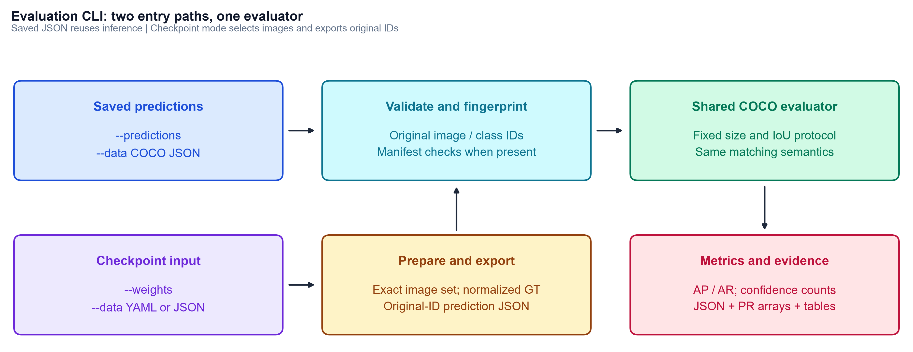
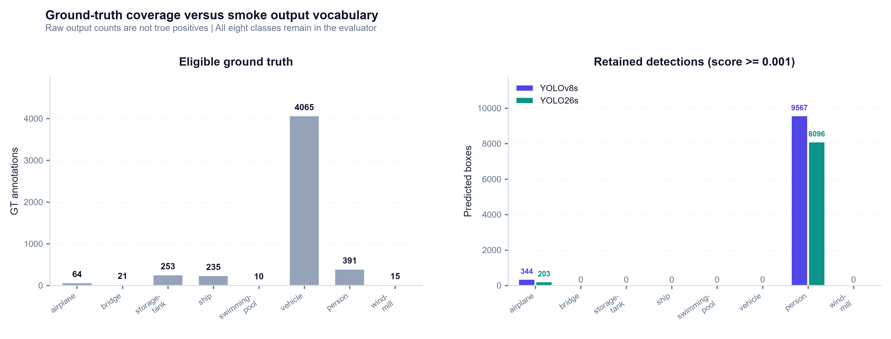
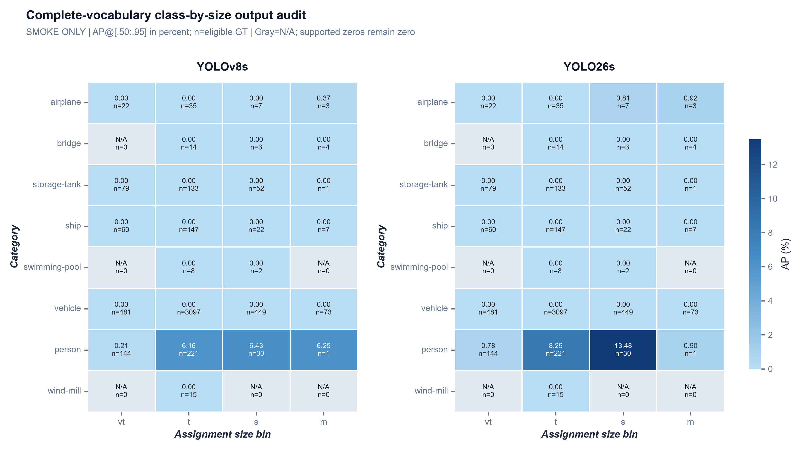

# Phase 4: Evaluation CLI integration and benchmark handoff

**Status:** **CLI/harness complete; final trained-model benchmarks pending.**

**Date:** 2026-11-01 (Asia/Saigon)

**Scope:** Public command, input selection, end-to-end execution, numerical equivalence and useful result interpretation. No final baseline score is claimed from pretrained smoke models.

## 1. Objective and deliverables

Expose the validated export/evaluation pipeline through **`sod eval run`**, so teammates can evaluate checkpoints or reuse saved predictions with consistent metrics and source identity.

| Artifact | Responsibility |
| :--- | :--- |
| `src/cli.py` | Command flags, clear errors, smoke/provenance labels and existing Rich table helpers; unrelated commands preserved |
| `src/eval/runner.py` | Shared orchestration, YAML/COCO input resolution, exact selected images, normalized GT and run-level provenance |
| `src/eval/coco_eval.py` | Optional operating confidence and rejection of cutoffs below the recorded export floor; clear top-level COCO schema validation |
| `tests/test_evaluation_cli.py` | CLI invocation, selection, mode/error handling, repeatability and checkpoint-mode orchestration tests |
| `src/eval/plots.py` | Three complementary Phase 4 figures; two additional Phase 3 diagnostic figures |
| `README.md` | Public evaluation examples and report links |

The command accepts the required **`--weights`, `--data`, `--split`** interface and a saved-prediction alternative. It prints **AP/AP50/AP75/AR (%)**, eligible GT support, and **TP/FP/FN/precision/recall** at IoU 0.50. JSON/tensor metrics retain their unrounded fractional values; console percentages are rounded to four decimal places.

## 2. Interface and input rules

| Mode | Inputs | Selection and behavior |
| :--- | :--- | :--- |
| **Saved predictions** | `--predictions RESULTS_JSON --data COCO_JSON` | Evaluate the exact export/annotation image set; no checkpoint loading, inference or local image directory required |
| **Checkpoint + YAML** | `--weights MODEL.pt --data DATASET.yaml --split val` | Resolve the YAML image directory; match every actual image filename to source COCO IDs; normalize that exact selection, export and evaluate |
| **Checkpoint + COCO JSON** | `--weights MODEL.pt --data COCO_JSON --image-root IMAGE_DIR` | Export/evaluate the explicit JSON image set from the supplied image root |

Exactly one of **weights** or **predictions** is required. `--split` accepts **train/val/test**. For explicit COCO JSON, its image records define the set: a `--split val` label does **not** transform a training JSON into validation data. For YAML, `--split` actually selects the corresponding directory entry.

For the prepared AI-TOD layout, source train/val JSON is inferred from the ancestor `annotations/` directory. Other layouts can pass **`--annotations`** explicitly. YAML mode currently supports a **single split directory**, rather than `.txt` lists or multiple directories. Missing/ambiguous roots, unknown image files, mismatched class vocabularies and malformed YAML are rejected. Saved-JSON mode deliberately uses COCO JSON directly, avoiding reconstruction of GT from YOLO labels or guessed annotations.

Additional options are **`--protocol assignment|upstream`**, **`--smoke`**, **`--output-dir`**, **`--device`**, **`--batch-size`**, and **`--confidence`**. Fresh output directories are required. `--smoke` is an explicit permission to run partial-vocabulary diagnostics, not a conversion into an eight-class benchmark.

**`--confidence` changes only the fixed-confidence operating summaries.** It does not discard predictions used by AP/AR accumulation. A cutoff below a manifest's export floor is rejected, because lower-score detections cannot be recovered from that saved file. In checkpoint mode, this error is checked **before inference**, avoiding a costly run that cannot answer the requested operating-point question.

## 3. Execution evidence

| Executed path | Images | Eligible GT | Exported/reused detections | Outcome |
| :--- | ---: | ---: | ---: | :--- |
| **Saved JSON: YOLOv8s** | 200 | 5,054 | 9,911 | **Pass - smoke only** |
| **Saved JSON: YOLO26s** | 200 | 5,054 | 8,299 | **Pass - smoke only** |
| **Repeated JSON: YOLOv8s** | 200 | 5,054 | 9,911 | **Pass - smoke only** |
| **YAML + checkpoint: YOLO26s** | 200 | 5,054 | 8,299 | **Pass - smoke only** |
| **JSON + checkpoint: YOLOv8s** | 2 | 61 | 401 | **Pass - smoke only** |

Both the Windows **`sod.cmd`** wrapper and **`python -m src.cli`** entry point were exercised. The 200-image JSON runs use the saved Phase 2 exports. The real YAML/checkpoint run used the current native YOLO26 pretrained checkpoint at 800 px, batch 4, CPU, eight PyTorch threads, **end-to-end mode** and a verified **1,500** internal cap. YOLOv8's two-image end-to-end check used batch 2 and class-aware NMS; it is a path check, not a comparable accuracy experiment.

**Measured invariants:**

- All AP/AR, per-class, support and operating-count dictionaries agree with the Phase 3 library evaluation for the same saved predictions. All saved tensor values and axis arrays match exactly: **maximum numeric difference 0**.
- Repeated YOLOv8 saved-JSON CLI evaluation produced **byte-identical metrics JSON**. This tests deterministic evaluation with fixed predictions, not a general guarantee about all inference devices.
- The native YAML/checkpoint run produced **byte-identical prediction JSON to Phase 2** and the same metrics as the saved-JSON path. Thus image selection, projection, class mapping and active head configuration did not change its measured surface.
- Complete manifests include zero-prediction images; the 200-image runs retain **5,054** eligible GT. No benchmark denominator was restricted to images/classes with detections.
- **21 test methods passed**, including four CLI integration methods with multiple subcases. Invalid/missing arguments, conflicting modes, unsupported splits/protocols, smoke rejection, invalid COCO/YAML, below-floor confidence, unknown image files and default annotation discovery were checked. Ruff checks passed.

These equivalence checks isolate **interface integration correctness**. They do not establish that the pretrained predictions are useful for the final AI-TOD task.

## 4. Three complementary figures and their implications

### Figure 1 - One measurement surface from two entry paths



The upper path reuses predictions; the lower path first resolves images and exports them. Both converge at the **same input validation and evaluator**, rather than maintaining separate metric implementations. A complete export manifest is verified when present; plain external JSON remains explicitly labeled as unverified provenance.

The numerical-equivalence results in Section 3 are evidence that this convergence works. **A changed interface without changed inputs** $\implies$ **unchanged metrics**. This makes cached JSON suitable for evaluator debugging, new plots and report iterations without spending inference time again. The actual cost reduction is the avoided inference work; no standardized speedup or latency claim was measured here.

### Figure 2 - The vocabulary gap explains why smoke scores cannot be baseline scores



The left panel counts eligible GT annotations; the right counts retained predictions at the **0.001** export floor. All eight classes remain in evaluation, while smoke mode intentionally exports only **airplane and person**.

The strongest mismatch is **vehicle: 4,065 GT and zero exported vehicle predictions**. Across the six excluded classes, **4,599/5,054 GT annotations (91.00%)** lie outside the smoke output vocabulary. Their absence is an intentional class-filter limitation, not evidence of an image-selection or matcher failure. Silently evaluating only predicted classes would hide that task mismatch.

Conversely, person has **391 GT**, but **9,567 v8 / 8,096 native** predictions. Large output volume is not broad correct recovery. At IoU .50 and score .001, the person matching diagnostic finds only **123/179 TP**, with **9,444/7,917 FP**. The native smoke run has fewer person outputs yet more matched GT in this particular ranking: a concrete counterexample to treating box count as recall. These counts are descriptive of the smoke data; they do not identify a trained-model or architectural advantage.

**Complete GT coverage + incomplete output vocabulary** $\implies$ **a valid pipeline diagnostic with an invalid claim to full-task detector performance**. A genuine eight-class checkpoint is required before the final benchmark can answer the project question.

### Figure 3 - Supported zero, absent support and category averaging are different



Each cell shows **AP@[.50:.95] (%)** and **eligible GT support**. Both models use the same color scale. **Gray N/A** means no eligible GT for that class/size slice; a numeric zero means GT exists but the predictions achieve no AP. Some values displayed as 0.00 may be rounded very small values; full-precision JSON remains authoritative.

The vehicle row has extensive support-**481 vt / 3,097 t / 449 s / 73 m**-but zero AP because vehicle is not exported in these smoke runs. Bridge-vt and several swimming-pool/wind-mill slices have **no GT**, so they correctly stay N/A instead of becoming artificial failures. The visible person contrast, especially **small AP 6.43% versus 13.48%**, is class-specific; medium person has only **one GT**, making its apparent reversal unreliable.

The heatmap also explains an aggregation subtlety: eligible category counts differ by area group-**5 vt / 8 t / 7 s / 6 m**. COCO AP averages eligible categories equally, not in proportion to the number of GT objects. For example, native **person tiny AP=8.2929%**, while all other supported tiny categories have zero AP in this smoke case; aggregate tiny AP is **8.2929/8=1.0366%**. It is not an instance-weighted vehicle-dominance calculation. The large missing-vocabulary instance share affects pooled recall, while supported-class zeros also depress macro AP through equal category weighting.

**Different class support and averaging denominators** $\implies$ **size-bin aggregate AP alone cannot establish a pure size effect**. Final analysis must inspect class-controlled comparisons and support, as well as overall micro-bin AP. Inclusive endpoints mean the four support counts in a row may overlap; do not sum them as distinct objects.

All three final saved figures were visually checked. They reuse project headers, fonts, colors, clean plotting conventions and 300-dpi export. The first figure explains workflow; the others expose coverage and metric semantics. None is included solely to repeat a score table.

## 5. Trained-baseline status and handoff

**No genuine AI-TOD-trained checkpoint is available locally.** Only the two explicitly COCO-pretrained weight files were found. A read-only query:

```powershell
kaggle kernels status miles2542/ai-tod-baseline-training
```

returned **permission `kernels.get` denied**. The error can reflect a private/inaccessible notebook or an unresolved slug; it does not establish whether training is queued, complete or failed. No remote state was inferred, and no job was launched or modified.

| Milestone | Status |
| :--- | :--- |
| Public CLI, both input modes, tables and artifacts | **Complete** |
| Fixture and real-image smoke integration | **Complete** |
| Identical-set library/CLI comparison and deterministic reuse | **Complete** |
| Genuine converged eight-class checkpoints with training provenance | **Awaiting Member 1 handoff** |
| Final two-model full-validation benchmark | **Pending those artifacts** |

Once artifacts arrive, verify model class names, checkpoint hashes and training split/epochs from the supplied logs. Evaluate both models against the same **2,804-image full validation set**, same source annotations, protocol and export caps. Use **`--data configs/aitod_full.yaml --split val`** with the actual checkpoint paths and without `--smoke`; verify the saved manifests and any cap hits. Default Ultralytics `save_json` output is not automatically a valid original-ID handoff: teammates should use this adapter/CLI or provide explicitly verified original image/category IDs.

This gate is deliberately recorded as **pending**, rather than filling a final benchmark table with pretrained smoke results. No full-model performance degradation or preferred detector is concluded at this phase.

## 6. Reproducible commands and outputs

```powershell
# Inspect the public interface
sod eval run --help

# Reuse saved smoke predictions; choose a new output directory
sod eval run --data runs/eval/input_audit/mini_val_ground_truth.json --predictions runs/eval/phase2_yolo26s_smoke/predictions.json --smoke --split val --output-dir runs/eval/yolo26s_json_repeat

# Exercise the full YAML-to-export-to-evaluation path with pretrained smoke weights
sod eval run --weights weights/pretrained/yolo26s.pt --data configs/aitod_mini.yaml --smoke --split val --device cpu --batch-size 4 --output-dir runs/eval/yolo26s_weight_repeat
```

| Output | Purpose |
| :--- | :--- |
| `run.json` | Completion marker, input mode, data/source hashes, split label, selected count and protocol |
| `evaluation/metrics.json` | Full-precision metric dictionaries and source provenance |
| `evaluation/curves.npz` | PR/recall/score tensors and axis definitions |
| `ground_truth.json` in checkpoint mode | Normalized copy of exactly the selected source annotations |
| `prediction_export/` in checkpoint mode | Predictions plus complete-image export manifest |

Actual check artifacts live under ignored `runs/eval/phase4_*`; CLI console logs and `phase4_integration_checks.json` retain supporting evidence. No temporary checking script was retained. Source datasets and earlier prediction exports were not modified.

## 7. Reporting standard and next review

Phase 3 Section 5 now includes **three figures**, quantitative size/ranking comparisons, localization sensitivity and raw-count confidence trade-offs. From this phase onward, reports should normally use **two or three complementary figures** with a distinct question per figure: **measured pattern → comparison → plausible interpretation → practical implication → limitation/support check**. Additional figures do not substitute for evidence or justify unsupported causal claims.

The implemented Phase 4 harness is complete; **final trained benchmarks remain pending**. [Phase 5](05_analysis_and_handoff.md) now provides the reusable analysis/handoff tooling, with final trained-model conclusions still awaiting genuine benchmark artifacts. No training, push, commit or PR was performed.

### Figure revision following review

The workflow now uses a **centered six-box layout**, larger headings/body text and distinct pastel backgrounds with darker matching text. The class-coverage chart uses **aligned vertical categories, consistent bar widths, compact panel spacing and direct count labels**, following the team EDA comparison layout. The heatmap retains a **shared linear AP scale**, now starting at light blue, with stronger white cell boundaries and **bold italic axis titles**; gray remains reserved for N/A. All three revised images were inspected. Numerical inputs and metric definitions are unchanged.
