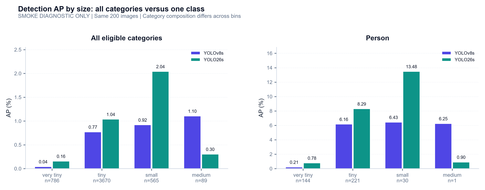
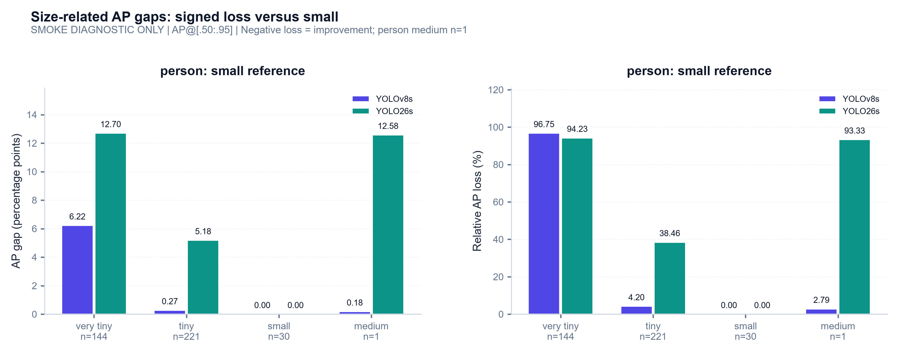
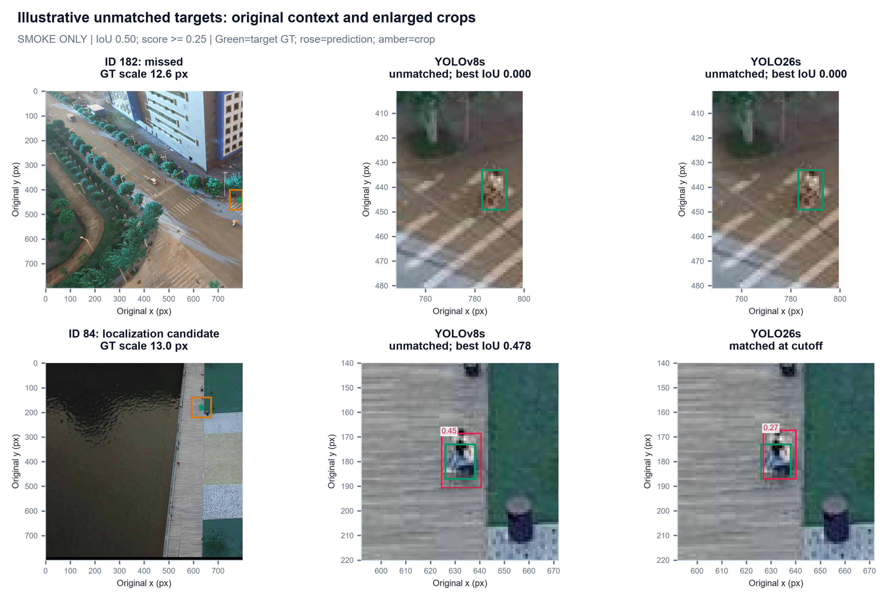

# Phase 5: Size analysis, visual evidence and evaluation handoff

**Status:** **Analysis tooling and diagnostic handoff complete. Final trained-model conclusions pending genuine checkpoints.**

**Date:** 2026-11-01 (Asia/Saigon)

**Evidence:** Two verified, saved 200-image pretrained smoke runs. No substitute training or inference was needed.

## 1. Objective and decision under the checkpoint constraint

Answer the parts of the size-analysis question that the available evidence supports, and make final benchmarking a reproducible input replacement rather than another implementation task.

| Available now | Completed in this phase | Requires genuine trained artifacts |
| :--- | :--- | :--- |
| Saved original-ID predictions, GT, manifests, metrics and PR arrays | Paired input verification, class-controlled AP gaps, confidence/cap diagnostics, representative errors and reusable figures | Final eight-class, 2,804-image baseline results |
| COCO-pretrained checkpoints with two shared output classes | Explicit **smoke-only** numerical handoff and three complementary figures | Converged checkpoint identity, training logs and class vocabulary |
| Validated evaluator and working public CLI | Rerun commands and schemas for baseline/P2/SAHI/NWD collaborators | Controlled scientific claims about trained detectors or interventions |

**Chosen approach:** reuse and independently reproduce the saved predictions; complete analysis and handoff now; retain an explicit final-data gate. A short local training run would introduce a different, unconverged experiment and would not supply the missing full-training comparison. The previous Kaggle access denial is not evidence of notebook completion or failure. This phase does not depend on querying it again.

**Completed analysis infrastructure** $\implies$ **no implementation dependency on Member 1's delivery date**. The final scientific answer remains dependent on appropriate trained-model evidence.

## 2. Method and reproducibility contract

Added **`src/eval/analysis.py`**, executable as a Python module, with two labeled existing CLI run directories and a fresh output directory. It:

1. Checks both completion records and current annotation/prediction **SHA-256** against the evaluated provenance.
2. Requires identical annotation bytes, exact image/category IDs and the complete evaluation protocol. When export manifests exist, also requires the same resolution, confidence floor, cap, augmentation, rectangular batching, class-agnostic setting, NMS IoU setting and target vocabulary. Native YOLO26 versus v8 postprocessing remains documented in the manifests.
3. Recomputes metrics from the recorded inputs and requires **exact equality** of all bin and per-class summaries to the saved metrics. No inference is run.
4. Calculates **signed AP gaps** and **relative losses** for one selected class; writes full-precision JSON and a portable Markdown comparison. Missing support and zero reference values remain explicit.
5. Reuses accumulated matches for confidence diagnostics and deterministic unmatched-target selection. Optional source imagery enables the context/crop figure.

The tool emits **`smoke_diagnostic_only`** if either run is smoke. Otherwise it emits **`training_provenance_review_required`**: a strict class mapping or an export manifest alone does not prove a checkpoint was trained correctly. External predictions without manifests retain their unverified status and receive no inferred confidence sweep below an unknown export floor.

### Gap definition

For reference AP $A_r$ and size-bin AP $A_b$, stored as fractions:

- **Absolute gap:** $100(A_r-A_b)$ **percentage points**.
- **Relative loss:** $100(1-A_b/A_r)$ **percent**; undefined if the reference is zero or missing.
- Negative values indicate an improvement over the reference, rather than being clamped to zero.

The present reference is **person-small**, with **30 GT**, rather than person-medium with **one GT**. This improves interpretability but is still a small, exploratory reference. Its choice is declared, not treated as a universal size baseline. Bins use the assignment's inclusive boundaries, so support can overlap.

## 3. Code and evidence checks

| Check | Actual result | Interpretation |
| :--- | :--- | :--- |
| Existing protocol/export/evaluator/CLI tests plus new analysis tests | **25 test methods pass** | Includes signed/undefined gaps, true match-based selection, confidence filtering, changed-input rejection, protocol mismatch and different export floors; **Ruff checks pass** |
| Reproduce both recorded CLI runs | **Exact bin/per-class equality** | Analysis is tied to the saved predictions and denominator |
| Pair export settings and target vocabulary | **Equal for the compared settings** | Native head differences remain explicit; no silent same-task assumption |
| Real-image failure figure | **Two deterministic examples**, with common crops and original coordinates | Illustrative, not an estimated population error breakdown |
| Figure review | **Three Phase 4 replacements and three Phase 5 figures inspected** | Legible saved outputs, rather than only successful plotting calls |
| Temporary code | **No standalone temporary scripts retained** | Durable logic is in the existing evaluation package |

Artifacts are in **`runs/eval/phase5_smoke_analysis/`**: `analysis.json`, `comparison.md`, and three PNGs. Report copies of the PNGs are under `assets/eval/phase5_*.png`. These reports and code are versionable; large predictions, images and checkpoints remain ignored.

## 4. Figure 1 - Aggregate scores and class-controlled patterns



Both panels show **AP@[.50:.95] (%)**, not AP50. Within each panel the models share a scale; the panels use different y ranges because their category averaging differs. Compare bar values and labeled units rather than visual heights across panels.

| Size | Person GT | v8 person AP (%) | 26 person AP (%) | 26 minus v8 (pp) |
| :--- | ---: | ---: | ---: | ---: |
| **Very tiny** | 144 | 0.2087 | 0.7772 | +0.5685 |
| **Tiny** | 221 | 6.1593 | 8.2929 | +2.1336 |
| **Small** | 30 | 6.4293 | 13.4754 | +7.0461 |
| **Medium** | 1 | 6.2500 | 0.8994 | -5.3506 |

**The strongest common pattern is the very-tiny deficit.** For the same class, both runs have much lower AP in very tiny than in tiny/small. This avoids attributing the entire aggregate contrast to different classes occupying different bins, although object context, visibility and sample difficulty are still uncontrolled. These observational slices do not establish that size alone caused the difference.

**The model contrast changes with size.** Native smoke outputs have higher person AP in the first three bins, with the largest observed difference in small. The medium reversal rests on a single GT and does not justify selecting v8 for medium targets. A monotonic rule such as "larger always means better" is not supported: v8 tiny/small/medium are similar, and native medium falls sharply.

**The left panel is a different aggregation surface.** Six output classes were filtered out in smoke mode, yet their supported GT stays in the evaluator. Supported categories are averaged equally, and category support differs by bin. Consequently, native small aggregate AP **2.0408%** and person-small AP **13.4754%** answer different questions. Neither can be reconstructed by averaging the four size-bin APs. The [Phase 4 heatmap](04_cli_and_baselines.md#figure-3---supported-zero-absent-support-and-category-averaging-are-different) exposes the support/zero distinction.

**Class-controlled weakness at very tiny scale** $\implies$ **a priority slice for later trained-model analysis**. It does not yet imply that P2, SAHI or NWD will fix it; those interventions must be compared with the same harness and controlled inputs.

## 5. Figure 2 - Absolute gaps and relative losses tell different stories



| Model | Very-tiny gap to small (pp) | Very-tiny relative loss | Tiny gap to small (pp) | Tiny relative loss |
| :--- | ---: | ---: | ---: | ---: |
| **YOLOv8s smoke** | 6.2206 | 96.75% | 0.2700 | 4.20% |
| **YOLO26s smoke** | 12.6983 | 94.23% | 5.1825 | 38.46% |

**A larger absolute gap does not mean worse very-tiny AP.** Native has the larger very-tiny gap, **12.70 versus 6.22 pp**, because its small-person reference AP is much higher. Its very-tiny AP is nevertheless also higher. Relative losses expose the proportional collapse: both retain only a small fraction of their small-person reference performance.

**Tiny and very tiny should remain separate.** V8's tiny-to-small gap is only **0.27 pp**, while its very-tiny gap is **6.22 pp**. Native's corresponding gaps are **5.18** and **12.70 pp**. Combining all targets below 16 px would conceal this contrast. The common size ordering is strongest below 8 px; the magnitude of the tiny/small contrast varies by saved model ranking.

The medium bars are included for transparency and explicitly marked **n=1**. Native's medium relative loss of **93.33%** is a one-object comparison and cannot establish a general medium-size failure pattern. No confidence interval or significance claim was estimated; small-reference ratios remain descriptive.

**Absolute loss + proportional loss + support** $\implies$ **a more interpretable degradation statement than one unlabeled percentage**. Later reports should preserve the same formulas, identify the reference and retain N/A/negative values when appropriate.

## 6. Figure 3 - Concrete missed and localization-sensitive examples



The first column provides original-image context; the other columns show the **same crop coordinates** for each model. Green marks the selected GT, rose retained same-class predictions, and amber the crop extent. Crops enlarge source pixels and do not restore lost detail. Scores are annotated; coordinates remain in original pixels.

**Selection rule:** person GT with area **4-256 px²**, not crowd/ignored, unmatched by standard COCO at **IoU .50 and score .25**. Within v8's unmatched set, select the lowest `(image_id, normalized_annotation_id)` for each of two conditions: (a) no overlap in the localization-candidate interval, (b) best retained same-class IoU in **[.10,.50)**. This is deterministic example selection, not representative random sampling. "Missed" is an operational unmatched label; it is not a TIDE background/recognition attribution. Overlapping detections or assignment competition can require further inspection.

| Example | Source annotation ID | GT scale | v8 result | Native result | Meaning |
| :--- | ---: | ---: | :--- | :--- | :--- |
| **Image 182** | 3742 | 12.65 px | Unmatched; best retained overlap 0 | Unmatched; best retained overlap 0 | Neither supplies an overlapping person box at the chosen cutoff |
| **Image 84** | 1615 | 12.96 px | Score **.4468**, IoU **.4777**, unmatched | Score **.2730**, IoU **.5699**, matched | Higher confidence does not ensure a passing localization match |

**Image 182:** both crops contain the annotated target but no retained person prediction overlapping it. This demonstrates a missed alert at the defined cutoff. It does not show that the network had no activation or could never produce a lower-score prediction. The target is near the image boundary; the crop is clipped to valid source pixels, which explains its asymmetric extent. That context is visible evidence, not an established cause.

**Image 84:** the v8 box is wider/taller than the annotated target and falls just below .50 IoU. The native box passes .50 despite its lower confidence. The box-size/placement difference illustrates why a visible detection can remain a false negative under a precise matching rule. At .75, neither of these particular boxes qualifies. These examples complement the [IoU-recall diagnostic](03_evaluator_validation.md).

**An approximate alert and an accurate bounding box are different requirements** $\implies$ **report localization quality alongside alert recovery**. These two cases cannot identify a preferred architecture or estimate how frequently each failure occurs. Full TIDE attribution remains with the failure-analysis owner.

## 7. Confidence and cap sensitivity from existing evidence

The tool records a **person confidence sweep** from .001 to .50 using raw match counts, without changing AP input rankings. The [Phase 3 cutoff figure and table](03_evaluator_validation.md) remain the visual reference. At .25, person TP/FP are **20/19 v8** and **31/25 native**; increasing to .50 leaves **4/4** and **8/2**. Fewer false alerts accompany much lower recovery. These are diagnostics, not threshold tuning on the benchmark split.

The saved tensors also measure mean recall across IoUs and eligible categories at COCO **per-image, per-category** caps:

| Model | AR@1 (%) | AR@100 (%) | AR@1500 (%) | Gain 100 to 1500 (pp) |
| :--- | ---: | ---: | ---: | ---: |
| **v8 smoke** | 0.1982 | 1.5864 | 1.6471 | +0.0607 |
| **native smoke** | 0.2376 | 2.2634 | 2.5351 | +0.2717 |

A cap of 100 loses some achievable recall even though no exported image hit the separate **1,500 total-output** cap. These are two different truncation stages. **No 1,500 export-cap hits** $\implies$ **no observed truncation at that output cap**, not invariance to a lower evaluator cap. This reuses existing AR tensors; no separate AP cap sweep was run. Genuine trained outputs can be denser and must be checked again before final benchmark completion.

## 8. Team handoff and exact rerun path

The portable numerical/status handoff is [evaluation_baselines.md](../evaluation_baselines.md). It includes the measured smoke snapshot and the unfilled official benchmark gate. Teammates can run:

```powershell
# Export/evaluate genuine eight-class checkpoints, once they exist.
# Replace the checkpoint placeholders with the actual supplied paths.
sod eval run --weights PATH_TO_V8_BEST.pt --data configs/aitod_full.yaml --split val --output-dir runs/eval/v8_full
sod eval run --weights PATH_TO_26_BEST.pt --data configs/aitod_full.yaml --split val --output-dir runs/eval/26_full

# Analyze those complete runs without rerunning inference.
python -m src.eval.analysis --run YOLOv8s=runs/eval/v8_full --run YOLO26s=runs/eval/26_full --output-dir runs/eval/full_analysis --image-root data/ai-tod-v2/splits/full/images/val
```

For the **executed** smoke analysis, replace the two run paths with `runs/eval/phase4_yolov8s_json` and `runs/eval/phase4_yolo26s_json`, use `--output-dir runs/eval/phase5_smoke_analysis_repeat` and the mini image root. Fresh directories protect previous artifacts. `--category-id` and `--reference-bin` support other class-controlled comparisons; absent classes fail clearly rather than silently selecting person.

| Producer / consumer | Handoff contract |
| :--- | :--- |
| Baseline / architecture / NWD owner | Genuine checkpoint and SHA-256, exact class names, training data/config/epochs/seed and logs; use the same held-out validation IDs |
| Inference / SAHI owner | COCO result array: `{image_id, category_id, bbox:[x,y,w,h], score}` in **original-image coordinates and original category IDs**; aggregate tiled detections to source images and document merging/filtering |
| Evaluator | Exact selected GT JSON, complete image coverage including empty detections, prediction manifest with hashes/floor/caps/mapping |
| Analysis / report owner | `metrics.json` fractions and N/A, `curves.npz` axes, `analysis.json` signed gaps/support/provenance, generated `comparison.md` percentages |
| Failure-analysis owner | Deterministic example IDs, GT source IDs, cutoff/IoU, same-class nearest overlap; run formal attribution separately |

**Official gate:** two genuine checkpoints; train/validation separation; same **2,804** validation image IDs and source GT; eight exact classes; native **800 px**; consistent settings/caps; review cap hits/sensitivity; verify training provenance and absence of smoke labels. Final model selection and ablation claims follow only after that review. The analysis tool deliberately does not auto-certify this gate from metadata alone.

## 9. Completion and review

| Deliverable | Status |
| :--- | :--- |
| Phase 4 requested typography/layout/heatmap revisions | **Complete**, em dashes replaced with literal `-` in that report |
| Reusable comparison/gap/selection implementation | **Complete** |
| Three Phase 5 figures with quantified analysis and practical implications | **Complete on labeled smoke evidence** |
| Baseline status page, reproducible commands, schemas and team handoff | **Complete** |
| Final trained-model scientific conclusions | **Pending actual artifacts**, not an implementation blocker |
| Commit / push / PR publication at the original phase checkpoint | **Not performed at that checkpoint**; subsequent feature-branch delivery is recorded in Git history |

Proposed PR title: **Add reproducible AI-TOD size evaluation and analysis**. Suggested description: "Export original-ID predictions, evaluate assignment/upstream micro bins, and expose checkpoint/saved-JSON evaluation through the existing CLI. Add verified comparison tools, support-aware figures and match-based examples; current results are explicitly pretrained smoke diagnostics, with genuine full-validation benchmarks pending. Validation: 25 test methods, exact COCO/reference checks from Phase 3, real CLI paths and analysis reproduction."

The agreed implementation phases are wrapped up for the available inputs. Review the revised figures and analysis handoff; the remaining external milestone is supplying and validating genuine trained benchmark artifacts.
