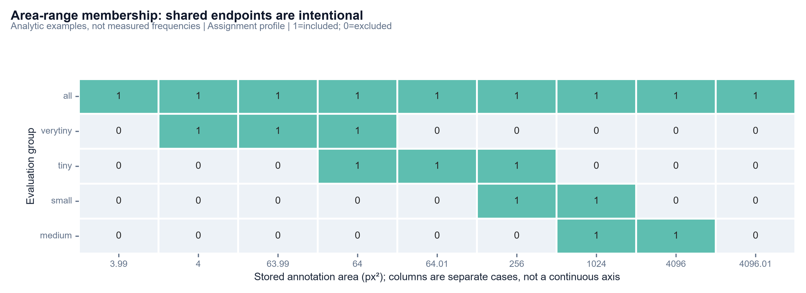
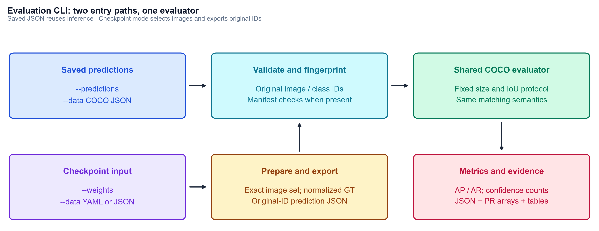

# AI-TOD Micro-Scale Evaluation Harness and Benchmark Integration Guide

This guide defines the standardized evaluation protocol, input contracts, CLI tooling, and verification parity for micro-scale object detection on the AI-TOD-v2 benchmark.

---

## 1. Overview & Motivation

AI-TOD-v2 poses unique challenges for standard object detection pipelines due to extreme target sparsity and scale concentration:
- **Micro-Scale Target Dominance:** The dataset contains 376,625 annotations across 14,018 aerial images ($800 \times 800$ resolution). Across the trainval splits, the median object scale $\sqrt{w \times h}$ is **11.83 px** (mean: **12.67 px**), with **86.54%** of all targets measuring $\le 16$ px.
- **Limitation of Standard COCO Metrics:** Standard MS COCO evaluation categorizes all objects smaller than $32 \times 32$ px into a single $AP_s$ bin ($32^2 = 1024$ px$^2$). In AI-TOD-v2, **98.20%** of all instances fall below 32 px. Standard COCO metrics lump distinct microscopic regimes together, obscuring severe localization degradation and feature map stride collapse (where targets become sub-pixel at $P_3$, $P_4$, and $P_5$ feature levels).
- **Dedicated Micro-Scale Partition:** To isolate detection performance across fine-grained sub-pixel regimes, this harness partitions bounding boxes into four canonical scale bins: Very Tiny ($AP_{vt}$), Tiny ($AP_t$), Small ($AP_s$), and Medium ($AP_m$).

---

## 2. Evaluation Protocol & Scale Intervals

### Canonical Scale Intervals

Evaluation bins are defined on original pixel bounding box area $A = w \times h$ (in pixels$^2$), corresponding to characteristic side length $S = \sqrt{A}$:

| Scale Bin | Area Range ($A$ px$^2$) | Scale Range ($S$ px) | AI-TOD Context |
| :--- | :--- | :--- | :--- |
| **$AP_{vt}$ (Very Tiny)** | $[0, 64]$ | $[0, 8]$ px | Sub-pixel at stride 8 ($P_3$); spans $\le 2 \times 2$ cells at stride 4 ($P_2$) |
| **$AP_t$ (Tiny)** | $[64, 256]$ | $[8, 16]$ px | Typical micro target (median 11.83 px); collapses at stride 16 ($P_4$) |
| **$AP_s$ (Small)** | $[256, 1024]$ | $[16, 32]$ px | Upper quartile of aerial targets |
| **$AP_m$ (Medium)** | $[1024, 10^{10}]$ | $\ge 32$ px | Extended structures (bridges, swimming pools, large facilities) |
| **$AP$ (All)** | $[0, 10^{10}]$ | All scales | Overall benchmark mean Average Precision |

```
Scale:    0 px         8 px         16 px        32 px               inf
Area:     0 px²        64 px²       256 px²      1024 px²            1e10 px²
Interval: [---- AP_vt ----]
                       [----- AP_t -----]
                                     [----- AP_s -----]
                                                  [-------- AP_m --------]
```

### Closed Boundary Handling

Following official COCO evaluation conventions, range intervals are **closed on both boundaries** ($low \le A \le high$):
- Bounding boxes falling exactly on a scale partition threshold (e.g., $A = 64$ px$^2$, corresponding to an $8 \times 8$ px box) are members of **both** adjacent scale bins ($AP_{vt}$ and $AP_t$).
- Because adjacent closed intervals share boundary instances, support counts across size groups cannot be summed as mutually disjoint counts.
- Category AP within a bin is averaged across supported categories; overall $AP$ is not an arithmetic average of the four size-bin APs.


*Figure 1: Closed boundary evaluation model showing interval overlaps at boundary transition points.*

### Detection Caps and Dense Scenes

- **Evaluator Caps:** Maximum detections evaluated per image/category are evaluated at thresholds `[1, 100, 1500]`.
- **High-Density Scene Handling:** AI-TOD-v2 scenes feature up to 815 annotations per validation image (and 1,729 in training splits). A restrictive cap (e.g. standard COCO 100 or 300) truncates valid true positives in clustered vehicular or port environments.
- **Export Limit:** Prediction exporters retain up to **1,500 detections globally per image** at a low confidence floor ($\ge 0.001$) to prevent premature recall truncation prior to COCO accumulation.

### Ground-Truth Sanitization Rules

Raw source annotation JSON files undergo non-mutating adaptation before evaluation:
1. **Zero-Dimension / Non-Positive Box Removal:** Annotations where $w \le 0$, $h \le 0$, or $A \le 0$ are excluded. The audit identified 40 degenerate instances in `aitodv2_train.json` and 9 in `aitod_val.json` (75,082 eligible annotations retained out of 75,091 total).
2. **Unclipped Positive Geometry Preservation:** Ground-truth boxes extending slightly beyond image borders (e.g., up to 44 px outside the $800 \times 800$ frame) are preserved with their original positive geometry and annotated areas. Silently clipping boxes alters the official benchmark surface.
3. **Annotation ID Reassignment ($1 \dots N$):** Raw AI-TOD annotations contain an entry with ID 0. COCOeval uses `0` as the unmatched sentinel inside `dtMatches`. All annotations are assigned 1-based positive IDs ($1 \dots N$), while preserving the raw ID in `source_annotation_id` for deterministic error tracing.
4. **Original Image and Category IDs:** Image IDs (including 0) and dataset category IDs ($0 \dots 7$) are preserved verbatim.

---

## 3. CLI Usage & Workflow

The evaluation CLI is accessible via `sod eval` (or `python -m src.cli eval`).


*Figure 2: End-to-end evaluation and cross-model comparison pipeline.*

### Evaluating Checkpoints (`sod eval run --weights`)

Evaluates a native `.pt` model checkpoint directly against a dataset split defined in a dataset configuration YAML:

```powershell
# Evaluate trained checkpoint on full AI-TOD-v2 validation split (CUDA)
sod eval run `
  --weights runs/train/yolov8s_aitod/weights/best.pt `
  --data configs/aitod_full.yaml `
  --split val `
  --output-dir runs/eval/yolov8s_full `
  --device 0

# Development sanity check on mini split with specific batch size
sod eval run `
  --weights runs/train/yolo26s_mini/weights/best.pt `
  --data configs/aitod_mini.yaml `
  --split val `
  --output-dir runs/eval/yolo26s_mini `
  --device cpu `
  --batch-size 4
```

### Evaluating Saved Predictions (`sod eval run --predictions`)

Evaluates pre-exported COCO prediction JSON against ground-truth annotations without requiring GPU resources, model checkpoints, or local imagery:

```powershell
sod eval run `
  --data runs/eval/input_audit/val_ground_truth.json `
  --predictions runs/infer/sahi/predictions.json `
  --split val `
  --output-dir runs/eval/sahi_full
```

### Comparing Two Runs (`sod eval compare`)

Computes statistical comparisons, class-controlled scale gaps, and metric deltas between two completed evaluation runs without repeating inference:

```powershell
sod eval compare `
  --run Baseline=runs/eval/yolov8s_full `
  --run Experiment=runs/eval/yolo26s_full `
  --reference-bin small `
  --category-id 6 `
  --output-dir runs/eval/comparison_v8_vs_26 `
  --image-root data/ai-tod-v2/splits/full/images/val
```

For a six-mode TIDE breakdown, size-group error composition, and an optional
qualitative gallery, see [Detection failure analysis](failure_analysis.md).

### CLI Options Reference

| Flag | Type | Description |
| :--- | :--- | :--- |
| `--data` | `Path` (Required) | Dataset YAML configuration (checkpoint mode) or COCO ground-truth JSON (predictions mode) |
| `--weights` | `Path` | Path to native PyTorch `.pt` model checkpoint |
| `--predictions` | `Path` | Path to external COCO predictions JSON file |
| `--split` | `str` | Dataset split: `val` (default), `train`, or `test` |
| `--output-dir`, `-o` | `Path` | Destination directory for evaluation metrics and PR curves (defaults to `runs/eval/result`) |
| `--annotations` | `Path` | Explicit path to source COCO annotations JSON (overrides default auto-discovery) |
| `--image-root` | `Path` | Root directory of evaluation images (required when using `--weights` with explicit COCO JSON) |
| `--confidence` | `float` | Operating-point confidence threshold (default: 0.25). Modifies operating TP/FP/FN counts; leaves ranked AP unchanged |
| `--device` | `str` | Computation device: `0` (CUDA GPU) or `cpu` (default: `cpu`) |
| `--batch-size` | `int` | Inference batch size (default: 4) |
| `--smoke` | `Flag` | Permits partial-vocabulary diagnostic runs (e.g. shared classes only); tags output as `smoke_only` |

---

## 4. Downstream Integration Contracts

Collaborators across functional tracks (baseline training, high-resolution / SAHI inference, architecture ablation) must adhere to the following schemas and data contracts.

### Prediction JSON Schema

External prediction files must serialize as a single top-level JSON array of detection objects:

```json
[
  {
    "image_id": 91,
    "category_id": 6,
    "bbox": [64.0, 32.0, 128.0, 64.0],
    "score": 0.7524
  }
]
```

| Field | Type | Specification & Invariants |
| :--- | :--- | :--- |
| `image_id` | `int` | Exact integer ID of the image from the evaluation ground-truth split. Do not use filenames or sequential loop counters. |
| `category_id` | `int` | Integer category ID in AI-TOD-v2 ($0\dots7$): `0: airplane`, `1: bridge`, `2: storage-tank`, `3: ship`, `4: swimming-pool`, `5: vehicle`, `6: person`, `7: wind-mill`. |
| `bbox` | `list[float]` | `[x_min, y_min, width, height]` in **original full-image pixel coordinates**. Width and height must be strictly positive. |
| `score` | `float` | Detection confidence in $[0.0, 1.0]$. Retain full floating-point precision; do not truncate with high display thresholds. |

### Downstream Track Guidelines

#### 1. Baseline Training Track
- Ensure all 8 target classes are configured in training YAMLs (`names` list matching the exact dataset mapping).
- Keep inference resolution at $800 \times 800$ (`--img-size 800`).
- Ensure the exported model checkpoint contains valid detection heads compatible with Ultralytics inference.

#### 2. High-Resolution & SAHI Inference Track
- **Tile Coordinate Un-tiling:** When running sliced inference over overlapping patches, bounding box coordinates must be mapped back to original image space ($x = x_{tile} + x_{offset}, y = y_{tile} + y_{offset}$) before export.
- **Overlap Non-Maximum Suppression:** Run cross-tile NMS (e.g., standard IoU 0.60–0.70) to suppress duplicate predictions generated in slice overlap regions.
- **Full Image Coverage:** Negative images (images with 0 detections) must remain in the evaluation set. If no detections are made across an entire run, write an empty JSON array `[]`.

#### 3. Architecture Ablation Track (P2 Heads, NWD, Dynamic Assignment)
- **Active Backend Verification:** When deploying end-to-end NMS-free models (e.g. YOLO26), ensure the active backend disables post-hoc NMS (`nms=False`) and maintains the internal maximum detections cap at 1500.
- **Exact Class Mapping:** Map class indices to COCO category IDs using canonical category strings rather than assuming identity index mappings.

### Generated Evaluation Artifacts

Every completed evaluation run writes the following standardized directory structure to `--output-dir`:

```
runs/eval/<run_name>/
├── run.json               # Run metadata, git revision, timestamps, parameters, SHA-256 provenance
├── manifest.json          # Image-level detection counts, cap hits, and file hashes
└── evaluation/
    ├── metrics.json       # AP/AR summaries, scale bin metrics, per-class metrics, operating counts
    └── curves.npz         # Full precision/recall/score arrays across all IoUs, classes, and areas
```

---

## 5. Evaluator Validation & Reference Parity

The evaluation harness wraps `pycocotools.cocoeval.COCOeval` to perform exact greedy matching and PR curve interpolation, avoiding non-standard matcher discrepancies.

### Pinned AI-TOD Reference Parity

The implementation was validated against official reference implementation [`cocoapi-aitod` (commit `44a230ae5197cb89bf9e5e62f313cac3ad30c7af`)](https://github.com/jwwangchn/cocoapi-aitod/blob/44a230ae5197cb89bf9e5e62f313cac3ad30c7af/aitodpycocotools/aitodpycocotools/cocoeval.py), SHA-256 `2c3f84612f448dccf085c72f20711f5fb8dcac3022e8f24cdf04af283a24fa1e`.

Across test suites spanning perfect predictions, empty outputs, class confusions, crowd annotations, and boundary conditions, the numerical parity is exact:

| Output Tensor | Dimension / Shape | Maximum Absolute Difference vs Reference |
| :--- | :--- | :--- |
| Precision Tensor | `[10, 101, 8, 5, 3]` (IoU $\times$ Recall $\times$ Class $\times$ Area $\times$ Cap) | **`0.000000000000`** |
| Recall Tensor | `[10, 8, 5, 3]` (IoU $\times$ Class $\times$ Area $\times$ Cap) | **`0.000000000000`** |
| Score Tensor | `[10, 101, 8, 5, 3]` | **`0.000000000000`** |

### Operating Points & Confusion Summaries

In addition to rank-based AP/AR metrics, the evaluator computes concrete operating summaries at score threshold $0.25$ and IoU $0.50$:
- **True Positives ($TP$):** Retained, matched, non-ignored detections.
- **False Positives ($FP$):** Retained, unmatched, non-ignored detections.
- **False Negatives ($FN$):** Unmatched eligible ground-truth annotations ($N_{GT} - TP$).
- **Micro Precision & Recall:** Computed over pooled TP, FP, and FN across images and categories.
- **Handling of Unrepresented Slices:** Categories or scale bins with no ground-truth support are emitted as explicit Python `None` / JSON `null` (rendered as `N/A`), avoiding misleading zero entries.

---

## 6. Data Integrity & Leakage Audit

To guarantee benchmark validity, dataset splits and annotation files can be audited using:

```powershell
python -m src.eval.audit
```

This verification utility:
1. **Verifies Split Isolation:** Computes rolling SHA-256 hashes across all 14,018 image files in 1 MiB blocks. Confirms zero shared image hashes and zero shared filenames between training and validation partitions.
2. **Reconciles Annotation Support:**
   - `aitodv2_train.json`: 11,214 images, 301,534 raw annotations (40 degenerate, 301,494 valid).
   - `aitod_val.json`: 2,804 images, 75,091 raw annotations (9 degenerate, 75,082 valid).
   - Combined trainval reconciliation: $301,534 + 75,091 = 376,625$ annotations across 14,018 images.
3. **Exports Normalized Ground Truth:** Writes sanitized evaluation ground truth with 1-based annotation IDs to `runs/eval/input_audit/val_ground_truth.json` for reproducible downstream evaluation.
