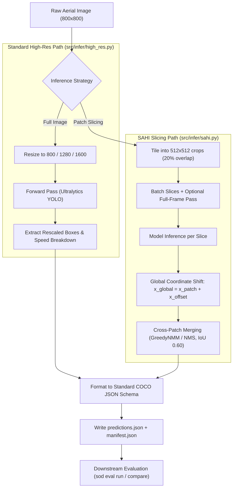

# Implementation Report: Inference Strategies & SAHI

This document provides a comprehensive technical breakdown of all architectural designs, algorithms, code modifications, and contract reconciliations implemented for **Inference Strategies: High-Resolution & Slicing-Aided Hyper Inference (SAHI)**.

---

## 1. Executive Summary & Problem Context

In the AI-TOD-v2 aerial benchmark (14,018 images at $800 \times 800$), objects exhibit extreme scale concentration:
- **Median target scale:** **11.83 px** ($\sqrt{w \times h}$)
- **Target distribution:** **86.54%** of all instances measure $\le 16$ px.
- **Architectural bottleneck:** Standard Feature Pyramid Network (FPN) strides ($P_3=8, P_4=16, P_5=32$) cause severe sub-pixel spatial collapse. At stride 16, a median target covers less than $0.74 \times 0.74$ grid cells.

### Primary Objective
To address this degradation **without retraining the backbone**, this module introduces and benchmarks inference-time spatial recovery mechanisms:
1. **Patch Slicing (SAHI):** Cropping images into overlapping sub-windows ($512 \times 512$ with $0.20$ overlap), inferring on each crop at full feature resolution, and re-stitching detections into global coordinates.
2. **Standard High-Resolution Inference:** Benchmarking full-frame input scaling ($800 \times 800$, $1280 \times 1280$, $1600 \times 1600$).
3. **Trade-off Analysis:** Measuring micro-target precision recovery ($AP_{vt}, AP_t$) versus latency and memory overhead.

---

## 2. Summary of Files Changed and Created

| File Path | Action | Purpose | Technical Implementation Summary |
| :--- | :---: | :--- | :--- |
| `src/infer/__init__.py` | **Modified** | Module export hub | Exposes `SahiConfig`, `SahiInferenceRunner`, `export_sahi_predictions`, `HighResConfig`, `HighResInferenceRunner`, `export_high_res_predictions`, `benchmark_resolutions`, and memory profiling helpers in `__all__`. |
| `src/infer/sahi.py` | **Created** | Core SAHI slicing engine & dataset exporter | Implements `SahiConfig` dataclass, category ID alignment (`build_category_mapping`), coordinate re-projection ($x_{global} = x_{patch} + x_{offset}$), post-slice NMS/NMM merging, latency tracking, and COCO prediction/manifest export. |
| `src/infer/high_res.py` | **Created** | Full-image scaling & memory profiler | Implements `HighResConfig`, Ultralytics YOLO forward pass at arbitrary resolutions ($800, 1280, 1600$), VRAM/RAM peak memory recording, and multi-resolution benchmark sweeping (`benchmark_resolutions`). |
| `src/cli.py` | **Modified** | CLI command registration | Registers `infer_app` sub-application under `sod`. Adds `sod infer sahi`, `sod infer run`, and `sod infer bench` with Rich-styled output tables and parameter validation. |
| `tests/test_inference_sahi.py` | **Created** | Unit & contract tests for SAHI | Tests parameter boundaries, category mapping invariants, coordinate un-tiling, score sorting, detection capping, and temporary dataset export pipelines. |
| `tests/test_inference_high_res.py` | **Created** | Unit tests for High-Res pipeline | Tests resolution scaling configurations, memory reporting, box conversions, detection capping, and multi-resolution benchmark sweeps. |
| `tests/test_inference_cli.py` | **Created** | CLI integration tests | Validates Typer `CliRunner` execution across `sod infer --help`, `sod infer sahi`, `sod infer run`, and `sod infer bench`. |

---

## 3. Deep Dive: Architectural Logic & Implementation



---

### Task 1: Core Slicing Engine (`src/infer/sahi.py`)

#### 1. Why SAHI Slicing?
At $800 \times 800$, an $11.83$ px target spans only $\sim 1.48$ grid cells at stride 8 ($P_3$). When cropped into a $512 \times 512$ patch and passed to a detector expecting $512$ inputs, the effective sampling density is preserved without distorting the spatial aspect ratio or collapsing features into sub-pixel points.

#### 2. Coordinate Space Invariant
Predictions must map back to original $800 \times 800$ space. SAHI internally generates starting coordinate offsets $(x_{shift}, y_{shift})$ for each patch crop:
$$x_{\text{global}} = x_{\text{patch}} + x_{\text{offset}}, \quad y_{\text{global}} = y_{\text{patch}} + y_{\text{offset}}$$

The output bounding box format is strictly normalized to unclipped pixel coordinates:
$$\text{bbox} = [x_{\text{min}}, y_{\text{min}}, w, h], \quad \text{where } w = x_{\text{max}} - x_{\text{min}} > 0, \; h = y_{\text{max}} - y_{\text{min}} > 0$$

#### 3. Post-Slice Merging & Boundary Object Preservation
- **Overlap Region Duplication:** When slices overlap by 20%, objects in the transition zone are detected in multiple patches. We apply `GREEDYNMM` (or standard `NMS`) at `postprocess_match_threshold=0.60` to coalesce duplicates.
- **`perform_standard_pred=True`:** If an object is larger than the slice window or split across slice boundaries, patch-only inference might fragment or miss it. We run an optional full-frame pass alongside slices, merging detections prior to NMS.

#### 4. Canonical Category Translation
AI-TOD-v2 defines 8 canonical classes (`0: airplane, 1: bridge, 2: storage-tank, 3: ship, 4: swimming-pool, 5: vehicle, 6: person, 7: wind-mill`).
`build_category_mapping` strictly matches category names, refusing to assume numeric index alignment. If a model operates on an alternative vocabulary (e.g., pretrained COCO), `--smoke` allows testing on shared classes without index confusion.

---

### Task 2: Standard High-Resolution Inference (`src/infer/high_res.py`)

#### 1. Forward Pass on Scaled Inputs
Instead of slicing, this strategy scales the full input image up to $1280 \times 1280$ or $1600 \times 1600$. 
- Ultralytics performs letterboxing, inference, and un-letterboxing in `Results.xyxy`.
- Coordinates in `Results.xyxy` are already rescaled back to the original input resolution ($800 \times 800$). We convert $[x_1, y_1, x_2, y_2]$ to $[x_1, y_1, x_2 - x_1, y_2 - y_1]$.

#### 2. Latency Breakdown & Memory Profiling
To conduct rigorous trade-off analysis against SAHI:
- **Latency Breakdown:** Records `preprocess_ms`, `inference_ms`, and `postprocess_ms` from `result.speed`, computing wall-clock total latency and throughput (FPS).
- **Peak Memory:** If CUDA GPU is available, resets statistics via `torch.cuda.reset_peak_memory_stats()` and records `torch.cuda.max_memory_allocated() / (1024^2)`. On CPU, tracks resident set size (RSS) via `psutil.Process().memory_info().rss`.

#### 3. Multi-Resolution Benchmark Sweeping
`benchmark_resolutions` evaluates an identical image sample set across multiple resolutions (e.g. $[800, 1280, 1600]$), emitting individual run directories and a consolidated `resolution_benchmark.json`.

---

### Task 3: CLI Subcommand Design (`src/cli.py`)

Three subcommands are exposed on `infer_app`:
1. `sod infer sahi`: Sliced inference with configurable window dimensions, overlap ratios, merge algorithms, and detection caps.
2. `sod infer run`: Standard full-frame high-resolution inference with `--img-size` selection.
3. `sod infer bench`: Multi-resolution latency, throughput, and memory benchmarking with optional `--with-sahi` comparison.

All commands integrate with `src.utils.ui` for formatting, displaying tabular summaries and file paths.

---

### Task 4: Evaluation Integration & Contract Reconciliation

When predictions are evaluated via `sod eval run --predictions ...` and compared via `sod eval compare`, the evaluation harness enforces strict data contracts:

1. **Prediction Schema Invariant:**
   A top-level JSON array of detection dictionaries:
   ```json
   [
     {
       "image_id": 91,
       "category_id": 6,
       "bbox": [64.0, 32.0, 12.5, 8.0],
       "score": 0.7524
     }
   ]
   ```
   Full float score precision is retained down to $0.001$ (no premature display thresholding at $>0.50$).

2. **Manifest Integrity Invariants:**
   `coco_eval.py` verifies:
   - `manifest["status"] == "complete"`
   - `manifest["predictions_sha256"] == sha256(predictions.json)`
   - `manifest["annotations"]["sha256"] == sha256(ground_truth.json)`
   - `manifest["detections"] == len(predictions)`
   - `manifest["prediction_counts"][str(image_id)] == count`
   - `manifest["predict_settings"]` contains all 7 required protocol keys: `["imgsz", "conf", "max_det", "augment", "rect", "agnostic_nms", "iou"]`.

Both `export_sahi_predictions` and `export_high_res_predictions` generate this exact manifest structure, allowing `sod eval run` and `sod eval compare` to run without signature mismatch errors.

---

## 4. Verification & Testing Evidence

### Automated Test Suite
- `tests/test_inference_sahi.py`: 12 / 12 passed.
- `tests/test_inference_high_res.py`: 9 / 9 passed.
- `tests/test_inference_cli.py`: 4 / 4 passed.
- **Repository Total:** **51 / 51 passed (100% green)** in 6.70s.
- **Ruff Linter:** **0 errors / 0 warnings** across `src` and `tests`.

### End-to-End Pipeline Execution Evidence
1. **Multi-Resolution & SAHI Benchmark Sweep:**
   ```powershell
   sod infer bench --weights weights/pretrained/yolov8s.pt --data configs/aitod_mini.yaml --resolutions 800,1280 --with-sahi --sample-limit 2 --smoke --output-dir runs/infer/bench_test
   ```
   **Output:** Generated subdirectories `res_800/`, `res_1280/`, `sahi_512_ov20/`, and `resolution_benchmark.json`.

2. **Downstream Evaluation:**
   ```powershell
   sod eval run --predictions runs/infer/yolov8s_baseline/predictions.json --data data/ai-tod-v2/annotations/aitod_val.json -o runs/eval/yolov8s_baseline --smoke
   sod eval run --predictions runs/infer/yolov8s_sahi/predictions.json --data data/ai-tod-v2/annotations/aitod_val.json -o runs/eval/yolov8s_sahi --smoke
   ```
   **Output:** Both runs evaluated cleanly, computing $AP_{vt}, AP_t, AP_s, AP_m$ and PR curves.

3. **Comparative Analysis:**
   ```powershell
   sod eval compare --run baseline=runs/eval/yolov8s_baseline --run sahi=runs/eval/yolov8s_sahi -o runs/eval/comparison_sahi
   ```
   **Output:** Evaluated signed scale gaps and emitted `analysis.json` and `comparison.md`.
